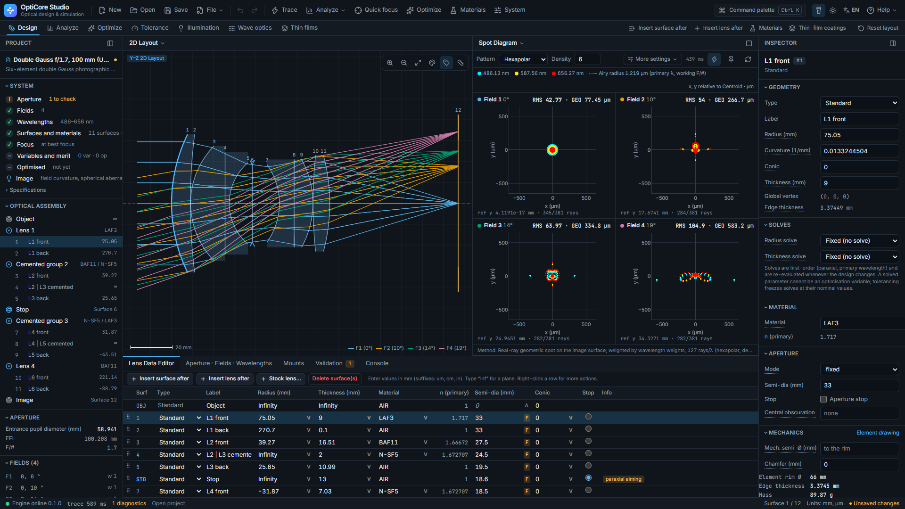
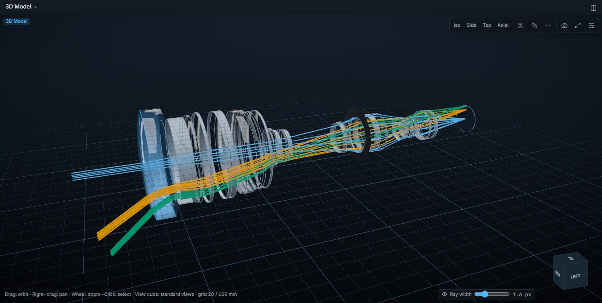
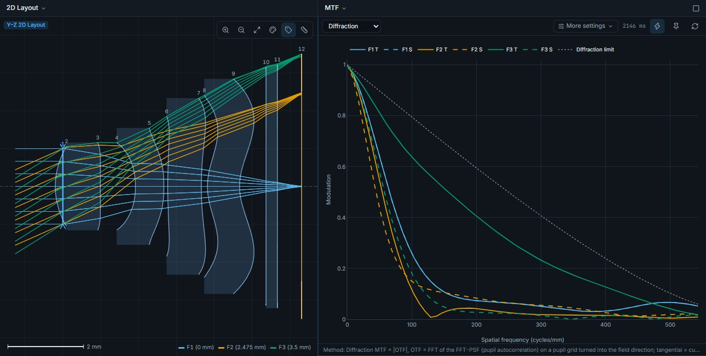
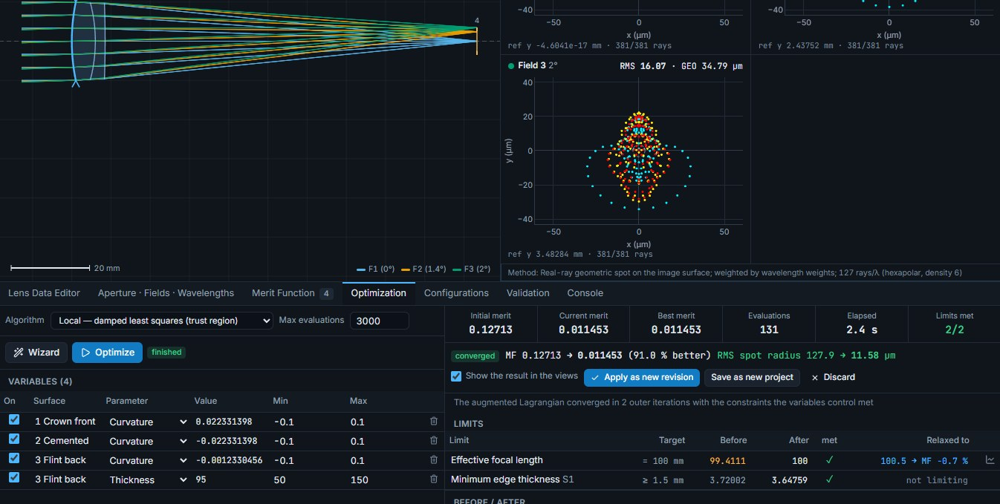
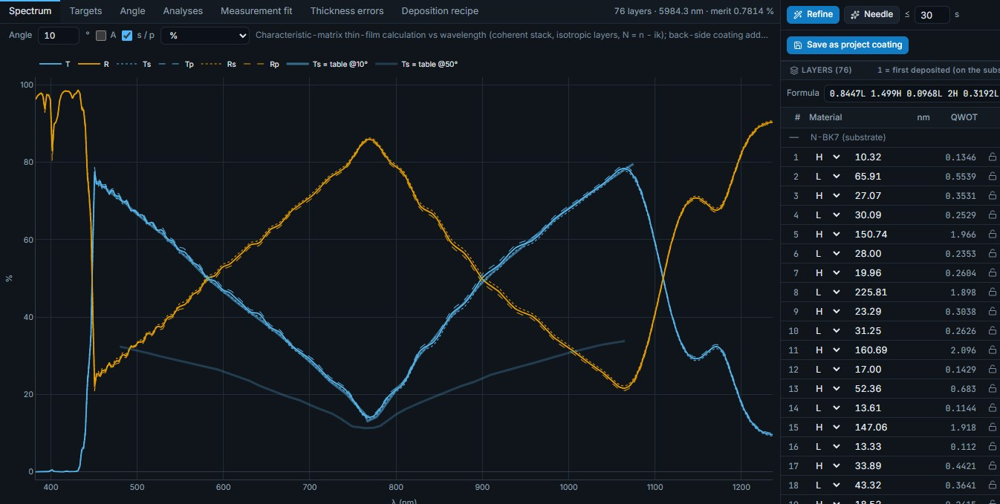
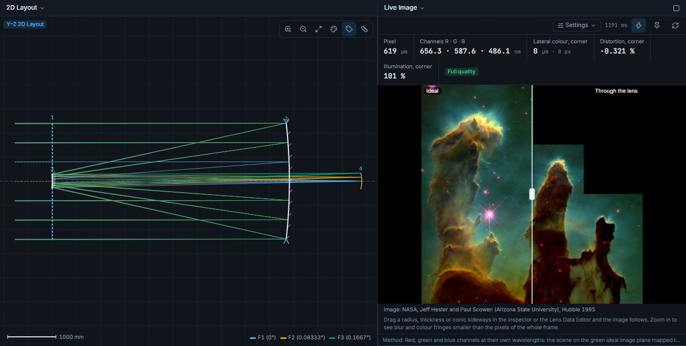
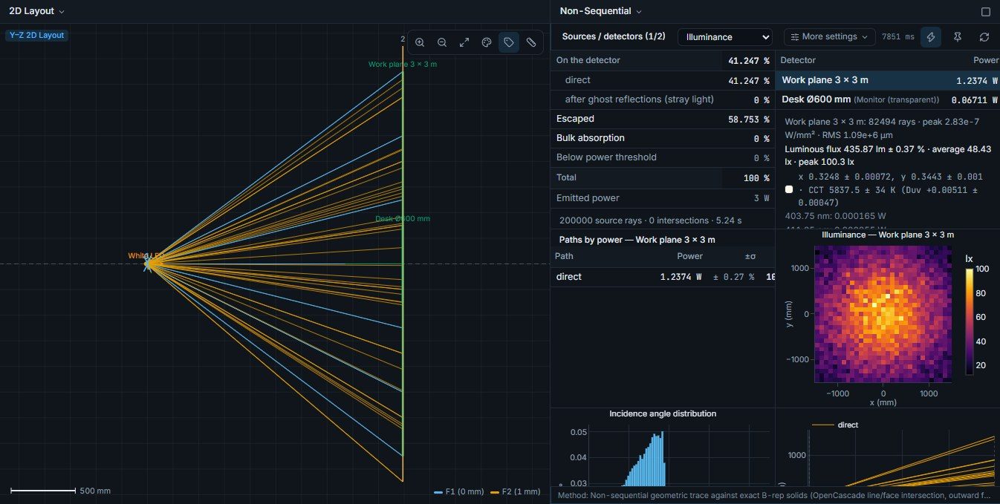
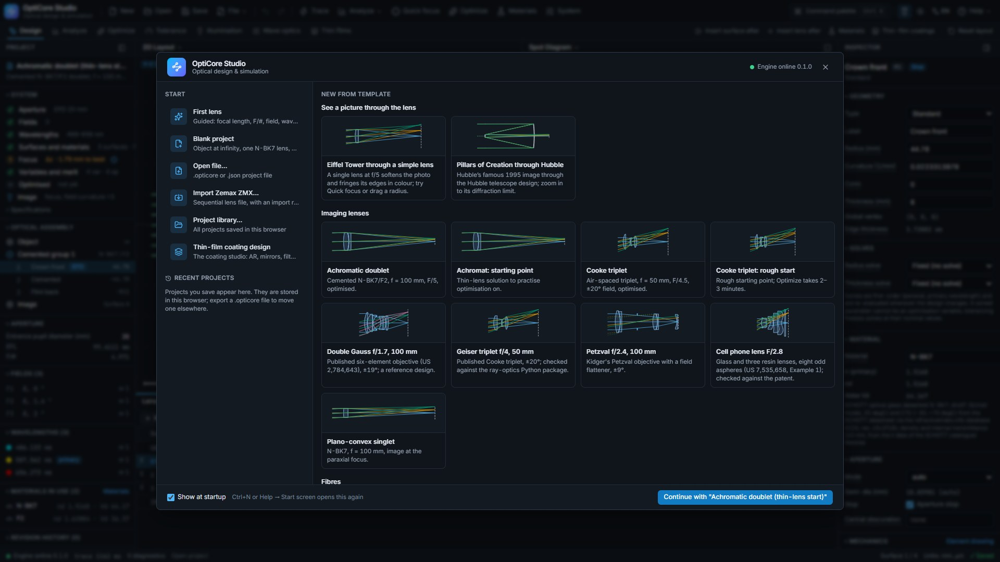
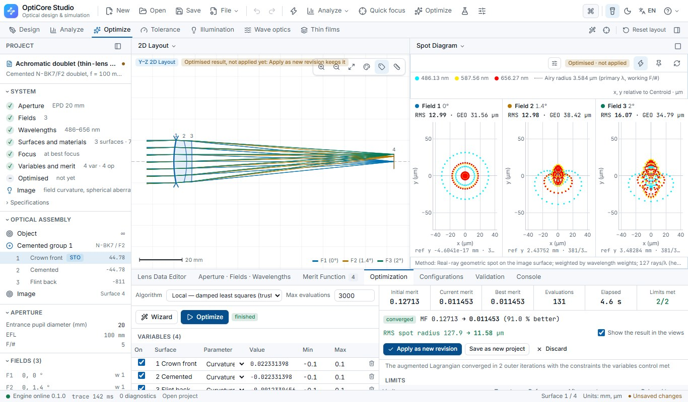

<p align="center">
  
</p>

<h1 align="center">OptiCore Studio</h1>

<p align="center">
  <b>Optical design and simulation in the browser.</b><br>
  Lens design, analysis, optimisation, tolerancing, thin-film coatings, illumination and wave optics,<br>
  on an open, independently implemented and test-validated Python engine.
</p>

<p align="center">
  <a href="https://github.com/Juusseli/opticore-studio/actions/workflows/ci.yml"></a>
  <a href="https://github.com/Juusseli/opticore-studio/releases/latest"></a>
  <a href="LICENSE"></a>
  
  
  <a href="docs/VALIDATION.md"></a>
  
</p>

<p align="center">
  <a href="#download">Download</a> ·
  <a href="#gallery">Gallery</a> ·
  <a href="#features">Features</a> ·
  <a href="#validated-against-published-work">Validation</a> ·
  <a href="#documentation">Docs</a> ·
  <a href="docs/ROADMAP.md">Roadmap</a> ·
  <a href="#license">License</a>
</p>

<picture>
  <source media="(prefers-color-scheme: light)" srcset="docs/img/workspace-light.png">
  
</picture>

## Why OptiCore Studio

- **Every number is computed.** The Python engine is the only source of optical
  results. The UI never fakes a value. An analysis that does not apply to a
  system says so, and planned features are documented rather than shown as dead
  buttons.
- **Validated, not just plausible.** 1280 engine tests check the physics against
  analytic results, published lens designs (patents and textbooks), independent
  software and contest data. The methods and tolerances are listed in
  [docs/VALIDATION.md](docs/VALIDATION.md).
- **The whole workflow in one place:**
  - sequential lens design and analysis;
  - optimisation with exact constraints and trade-off curves;
  - Monte Carlo tolerancing with yield;
  - ISO 10110 element drawings and STEP/IGES export to CAD.
- **Beyond lenses:**
  - a thin-film coating studio;
  - non-sequential stray light and illumination with photometry;
  - wave optics: fibre modes, RCWA gratings and metasurfaces, physical-optics
    propagation and FDTD.
- **Runs on your computer.** No account and no cloud. Projects stay in your
  browser and export as checksummed `.opticore` JSON files.
- **A modern interface:**
  - undo and redo for every edit, and live updates while you type or drag a value;
  - a command palette and keyboard shortcuts;
  - dark and light themes;
  - a layout that works from a 1366 px laptop to a 4K monitor;
  - English user interface, with Finnish available.

## Download

| System | Package |
|---|---|
| **Windows** 10 and 11, 64-bit | **[OptiCore-Studio-Setup.exe](https://github.com/Juusseli/opticore-studio/releases/latest)**: run it, and the program opens when it is installed. No administrator rights are needed, and nothing else to install. |
| **Linux**, x86-64 (glibc 2.35 or newer) | **[OptiCore-Studio-x86_64.AppImage](https://github.com/Juusseli/opticore-studio/releases/latest)**: make it executable (`chmod +x`) and run it. |

The program opens in its own window (Microsoft Edge or Chrome in app mode, or your
default browser) and works offline. Your projects are kept on your computer; use
*Export* for `.opticore` backup files. Uninstall it from *Settings → Apps* on
Windows, or delete the AppImage on Linux. On macOS, run it from source (below).

Every release lists the SHA-256 sums of its files. The Windows files are signed as
described in the [code signing policy](docs/CODE_SIGNING.md).

## Run from source

For development, or on macOS. You need **Python ≥ 3.11** and **Node.js ≥ 20**,
plus about 1 GB of disk space for the engine's environment (NumPy, SciPy and the
OpenCascade CAD kernel).

**Windows:** double-click **`Start OptiCore.bat`**. It installs everything on the
first start, which takes a few minutes. It then starts the engine and the user
interface, and opens <http://localhost:5173>. Close the window to stop the program.

**macOS / Linux:**

```bash
./scripts/dev.sh
```

<details>
<summary>Step by step (any platform)</summary>

```bash
# 1. the engine (Windows: .venv\Scripts\python instead of .venv/bin/python)
cd backend
python -m venv .venv
.venv/bin/python -m pip install -e ".[dev]"
.venv/bin/python -m uvicorn opticore.api.main:app --port 8000

# 2. the user interface (second terminal)
cd frontend
npm install
npm run dev
```

Open <http://localhost:5173>. The dev server proxies `/api` to the engine on port
8000, or to `OPTICORE_ENGINE_URL` when that is set.

To run the program as the packages do (one process, in an app window), build the user
interface once (`npm run build` in `frontend`) and run
`.venv/bin/python -m opticore.desktop` in `backend`.

If port 8000 is taken, `Start OptiCore.bat` and `scripts\dev.ps1` move the engine
to the first free port from 8010. The start stops if port 5173 is taken, which
usually means another OptiCore window is still open.

</details>

Then pick a template on the start screen, for example *Achromat: starting
point*, and follow the [five-minute tour](#five-minute-tour).

## Gallery

<table>
  <tr>
    <td width="50%"><a href="docs/img/gallery-3d.jpg"></a><br><b>3D model.</b> A 7× zoom from a Canon patent: 50 surfaces, physically based rendering, section plane, view cube.</td>
    <td width="50%"><a href="docs/img/gallery-analysis.jpg"></a><br><b>Analysis.</b> A cell phone lens with eight odd aspheres (US 7,535,658) and its diffraction MTF. Spot diagrams, fans, wavefront, PSF and more update live.</td>
  </tr>
  <tr>
    <td><a href="docs/img/gallery-optimization.jpg"></a><br><b>Optimisation.</b> Damped least squares with exact limits: RMS spot 128 → 12 µm, EFL held at 100 mm. Results are applied only as a new revision.</td>
    <td><a href="docs/img/gallery-thin-films.jpg"></a><br><b>Thin films.</b> The coating studio on the OIC 2019 contest problem: 76 + 56 layers on both faces, merit 0.781 (the contest's designs: 0.44–2.14). Shown at 10°; the faint curve is the 50° target.</td>
  </tr>
  <tr>
    <td><a href="docs/img/gallery-live-image.jpg"></a><br><b>Live image.</b> A photo through the lens in colour, following every edit. Here, Hubble's Pillars of Creation through the Hubble telescope design.</td>
    <td><a href="docs/img/gallery-illumination.jpg"></a><br><b>Illumination.</b> A non-sequential trace of an LED downlight: lux map, luminous flux, CCT and Duv with standard errors, and an energy budget.</td>
  </tr>
</table>

## Features

| Area | Highlights |
|---|---|
| **Lens design** | Spherical, conic, even and odd aspheric, biconic, Zernike, Q-type and XY freeform surfaces; diffractive surfaces; ideal lenses; mirrors and coordinate breaks; multiple configurations (zooms, conjugates); paraxial solves and pickups; the design advisor; stock lenses |
| **Analysis** | Spot diagrams, ray and OPD fans, field curvature and distortion, chromatic focal shift, wavefront and Zernike terms, FFT, Huygens and vector PSF, diffraction MTF with a sensor model, relative illumination, image simulation, the live image, polarisation, ghosts |
| **Optimisation** | Merit function editor; damped least squares (trust region); exact limits by an augmented Lagrangian, with the price of each limit; trade-off curves; parallel differential evolution and multistart; glass substitution; a design-space map of six lens forms with its Pareto front |
| **Tolerancing and manufacturing** | Sensitivities, RSS estimate and Monte Carlo with compensators; yield against a specification; inverse-sensitivity allocation; ISO 10110 element drawings; mechanics, mass and cost; temperature and pressure |
| **Thin films** | Transfer-matrix engine with measured n, k films and metals; 29 built-in coatings; refinement and needle optimisation of one or both faces; GD/GDD and colour targets; reverse engineering of measured spectra; deposition recipes |
| **Non-sequential and illumination** | Exact-solid tracing of lenses and CAD bodies; Fresnel and coating ghosts; ABg and Harvey surface scattering with importance sampling; general sources and detectors; photometry and colorimetry (lux, lumens, CCT); stray-light path table |
| **Wave optics** | Exact fibre modes (step, graded, layered and photonic-crystal fibres); RCWA for 1D and crossed gratings and metasurfaces; physical-optics propagation with coupling efficiency; BPM; 2D and axisymmetric 3D FDTD |
| **Files and CAD** | Versioned, checksummed `.opticore` JSON projects with revision history; Zemax ZMX import with a diagnostics report; AGF glass catalogues; STEP/IGES/STL import (OpenCascade); STEP/IGES export of the optical design |
| **Materials** | Built-in glasses with cited sources; about 1600 manufacturer glasses installed from refractiveindex.info (CC0); ten dispersion models; measured (tabulated) materials; Abbe diagram |

<details>
<summary><b>Full feature list</b></summary>

| Area | Implemented |
|---|---|
| Modelling | Sequential systems: object/image, plane, spherical, conic, even-asphere (A4…A18), odd asphere (r¹…r¹⁶, ZMX ODDASPH), biconic (incl. cylinder lens), Zernike sag (Fringe Z1–Z37 freeform), Forbes Q-type (Qcon, Qbfs; conversion from even aspheres) and XY-polynomial freeform surfaces, diffractive surfaces (gratings, diffractive lenses), ideal (paraxial) lenses, mirrors, coordinate breaks (decenter/tilt, both orders), cemented groups, aperture stop, fixed/automatic apertures, infinite and finite conjugates, multiple fields (angle, object height, real or paraxial image height) and wavelengths, object-space telecentric systems; field vignetting factors (VDX/VDY/VCX/VCY) with automatic *Set vignetting* from the apertures; central obscurations (annular pupils in every analysis, chief rays kept as references) |
| Ray tracing | Exact vectorised real-ray tracer: closed-form conic intersection, Newton-refined aspheres, vector Snell refraction, reflection, TIR detection, aperture clipping (vignetting), absorption, optional Fresnel transmission, optical path length, explicit per-ray failure status; paraxial or iterative real ray aiming |
| Paraxial | EFL, BFL, FFL, principal planes, entrance/exit pupils, F/#, working F/#, NA, magnification, Lagrange invariant, Seidel sums (S_I…S_V, C_L, C_T) |
| Analyses | 2D layout, 3D model, spot diagram (RMS/GEO, Airy disc), ray fans, OPD fans, wavefront map with Zernike fit, interferograms (single/double pass, tilt fringes) with phase-shifting recovery of the wavefront, spectrometer analysis (calibration, linear dispersion, resolution, grating resolving power over a wavelength sweep), FFT PSF and Huygens PSF (tilted/defocused image planes) with Strehl and encircled energy, Gaussian-beam propagation (waist, Rayleigh range, M²), polarisation pupil (3D polarisation ray tracing: transmission, diattenuation, retardance, output ellipses, the beam's Mueller matrix and depolarisation index; uniaxial crystals such as calcite and quartz with ordinary and extraordinary waves, walk-off and wave plates; ideal polarisers and retarders), vector (Debye–Wolf) PSF for high numerical apertures (linear, circular, radial and azimuthal input, longitudinal field), two-surface ghost analysis (ghost focus, footprint, energy, ranked by relative irradiance), diffraction and geometric MTF (with a sensor: pixel MTF, system MTF and Nyquist), relative illumination (real rays, energy form), image simulation of test scenes onto a sensor (distortion, relative illumination, field-dependent PSFs, pixel integration, shot and read noise), field curvature & distortion, longitudinal aberration, chromatic focal shift, dispersion curves, system data — all live-updating |
| Materials | 22 built-in materials with cited sources (SCHOTT glasses, fused silica, CaF₂, sapphire, calcite, quartz, polymers); manufacturer glass catalogues installed with one click from the refractiveindex.info database (CC0: SCHOTT, OHARA, HOYA, CDGM, HIKARI, SUMITA, …, about 1600 glasses) or imported from AGF files (formulas 1–13), self-checked against the catalogue Nd/Vd, with status, dn/dT, density, cost and internal transmittance; kept in the browser, used glasses copied into the project; Sellmeier, Schott, extended, Herzberger, Conrady, handbook, Cauchy, polynomial, constant and tabulated (measured CSV) models; custom materials stored in the project; range/extrapolation warnings; Abbe diagram & comparison |
| Environment | Opt-in temperature and pressure model: air index (Edlén/Kohlrausch), glass dn/dT (absolute Schott model) relative to the system air, thermal expansion of glass elements, spacers, housing and mirror substrates from 20 °C; temperature and pressure per configuration; temperature/pressure analysis with focus shift, focus spread and depth of focus; spacer expansion as an optimisation variable for passive athermalisation; mount tree (parts with their own materials and temperatures, linked to CAD parts, holding lenses and the image plane) and per-element temperatures |
| Configurations | Multi-configuration editor (zoom positions, conjugates, alternative glasses/apertures): per-configuration thickness, radius, conic, material, semi-diameter, decenter/tilt and aperture; active configuration drives every view; merit operands and variables per configuration for multi-configuration optimisation; two-conjugate sample |
| Solves | Paraxial thickness solves (marginal/chief-ray height, e.g. automatic paraxial focus), curvature solves (marginal/chief-ray angle, F-number) and thickness/radius pickups; resolved by the engine for every analysis and optimisation step; shown read-only with an S/P badge |
| Live image | A test scene or your own photo through the lens in colour, following every edit: red, green and blue mapped through their own chief rays (lateral colour fringes) and blurred by their own PSFs (axial colour), with relative illumination; zoom to 32× into any region, a before/after divider; diffraction PSFs with adaptive sampling, geometric where the aberrations are many waves; drag any radius or thickness sideways to see the image change (one undo step per drag); the photo stays in the browser; built-in example photos (Eiffel Tower, CC0; Hubble's Pillars of Creation, NASA) and two start-screen examples that open straight in the live image |
| Light sources | Point, disk, rectangle, sphere and box emitters with uniform or Gaussian profiles and collimated, isotropic, Lambertian, cosⁿ, cone, Gaussian or tabulated angular laws; Gaussian beam sources (waist, M², waist position: converging or diverging, with divergence and Rayleigh range from the engine); point any source or detector by angles, a direction vector or an aim point (it stays aimed when moved), with arrows in 2D and 3D; spectra generated as blackbody, Gaussian line or flat band; anchored to surfaces |
| Stock lenses | A built-in generic library of 740 lenses (plano/biconvex, best form, meniscus, plano/biconcave in N-BK7, fused silica, N-SF11, CaF2; achromats in three glass pairs) and your own catalogues from vendor ZMX files or CSV (kept in the browser); search and insert a lens either way round; build systems of 1–3 stock lenses for a focal length or a magnification (exact first-order spacing, third-order ranking, real-ray prescreen, air spaces optimised on every core) or match an existing design's elements to stock parts, with allowed glasses; results on the design space map |
| Design space | Many optimised designs of one specification (focal length, F/#, field, maximum length) over six lens forms (singlet, cemented and air-spaced doublets, Cooke triplet, Petzval, double Gauss) with crown/flint pairs from the built-in glasses, the project's or a catalogue; run on every processor core with progress and cancel; a map of RMS spot, MTF, length, glass mass or cost, distortion and tolerance sensitivity with the Pareto front; hover for the layout and numbers, open any design as a project or as a new revision |
| Design advisor | What limits the image, per field: Zernike classes of the real wavefront (focus error separated from blur), field curvature, axial and lateral colour, distortion, the guilty surfaces from the third-order sums; ranked suggestions (refocus, bend at constant power, radius, stop position, gaps, thicknesses, conics, neighbouring glasses), each a real merit evaluation of the changed design; *Apply* as one undoable edit |
| Optimisation | Merit function editor (RMS spot and RMS wavefront with Gaussian pupil quadrature, MTF at frequency, EFL, BFL, F/#, track, magnification, axial colour, distortion, thickness / edge-thickness bounds, beam diameter and power on a non-sequential detector from the project light sources); limits (focal length, F/#, length, edges, distortion, lateral colour, chief-ray angle, …) met exactly by an augmented Lagrangian with the price of each limit (how much the merit gains if it is relaxed) and a one-click trade-off curve computed on every core; bounded trust-region least squares, differential evolution (parallel), multistart; live progress, pause/resume/stop, live geometry preview, sensitivities, before/after comparison (including the RMS spot between the fields, with a warning where the image falls apart unseen), glass substitution (discrete material variables with re-optimisation per candidate); apply as a new revision (never overwrites silently) |
| Tolerancing | Sensitivity analysis, RSS estimate and seeded Monte Carlo for radius, thickness, conic, power and irregularity in fringes (ISO 10110-5), Zernike form terms, index and Abbe number, and exact surface/element decenters and tilts; RMS spot, RMS wavefront, merit or MTF criterion; yield against a specification with its 95 % interval; inverse-sensitivity allocation of the tolerances to the specification, confirmed by Monte Carlo; per-trial compensators (e.g. back focus); default commercial/precision/high-precision sets; histogram and cumulative distribution; runs in the background with progress and cancel |
| Projects | Versioned `.opticore` JSON format with SHA-256 checksum (byte-identical between browser and engine), browser library (IndexedDB), autosave and crash recovery, revision history with restore, save/save-as/duplicate/rename/delete, templates, export/import |
| Coatings | Thin-film transfer-matrix engine (s/p, any angle, complex index n − ik); measured film and metal materials with n and k (SiO₂, TiO₂, Ta₂O₅, Nb₂O₅, HfO₂, Al₂O₃, MgF₂, ZnS, Si₃N₄; Ag, Au, Cu, Cr, Al); built-in library of 29 coatings of these materials with stated specifications (MgF₂, exact V-coats 355–1550 nm, broadband AR, HR stacks, protected, enhanced and UV aluminium, protected silver and gold, a dispersive mirror, hot and cold mirrors, edge, band-pass and notch filters, 50/50 and MacNeille beam splitters); coated back faces with substrate absorption and group delay; measurement fitting of thicknesses, film indices, dispersion and absorption (local or global); colour under CIE D65, D50, D55, D75, A, C, F2, F7, F11 for the 2° and 10° observers; coating editor for project coatings (fixed-index, absorbing and dispersive material layers, metal mirror substrates) with analyses: spectrum and optical density, angle curves, phase, GD and GDD, ellipsometric ψ/Δ, colour (D65: x y, L*a*b*, Rv/Tv), standing-wave field with absorptance per layer, index profile; coated lens surfaces and mirrors in throughput, polarisation and ghost analyses and the throughput operand; R(λ) preview in the inspector; *Thin films* workspace with the coating studio (library of project coatings, worked examples, surfaces and built-ins; targets for R/T/A, GD, GDD, phase, retardance, Rv/Tv and L*a*b*, also as tabulated curves from text or CSV; stack formulas such as (HL)^7 H; admittance diagram; reverse engineering of measured spectra) and coating designer (starting designs incl. metal mirrors, refinement and needle optimisation of one face or both faces of a plate, angle curves and R(λ, θ) maps, optical density, Monte Carlo thickness errors, deposition recipe with optical-monitor and crystal data, CSV export); design a coating for any selected surface from its real ray angles, keep each design with its coating, and optimise coatings in the lens optimiser (layer variables, surface-reflectance and throughput operands); Coatings analysis of every surface |
| Manufacturability | Lens elements as parts: mechanical semi-diameters with flats, 45° chamfers, edge thickness, volume and mass (catalogue densities), relative cost where the catalogue gives it; ISO 10110 element drawings (SVG with embedded data, print to PDF) with the project's tolerances (3/A(B/C), 4/σ, Δnd, ΔVd); spacers, cells and a simple barrel in the CAD export; opt-in catalogue internal transmittance in the trace and throughput |
| Sweeps & reports | 1D/2D parameter sweeps of merit metrics (line plots and contour maps, current design marked); one-click self-contained HTML engineering report (prescription, first-order data, spot/MTF/field/throughput charts, optimisation and tolerance results, diagnostics, project checksum) |
| Import | Zemax ZMX (sequential, incl. paraxial surfaces and image-height fields; glasses from imported catalogues) with a detailed per-item diagnostics report; AGF glass catalogues; STEP/IGES CAD models (OpenCascade: exact volume/area, body names) and STL meshes, placed and shown in the 3D view (geometry only, not ray traced) |
| CAD in the optical model | Imported STEP/IGES lenses and mirrors recognised on their exact B-rep (spheres/planes exact, other faces fitted) and inserted into the prescription at their CAD position or on axis; any CAD body can be an absorber, mirror or refractive solid in non-sequential tracing, with an optional coating and a Lambertian, Gaussian, ABg or Harvey–Shack surface scatter model; STEP/IGES assembly trees with per-part visibility, highlighting, properties and optical roles; 3D distance and exact clearance measurement; CAD sections in the 2D layout |
| Wave optics | Exact fibre modes from Maxwell's equations (vector TE/TM/HE/EH and LP modes of step-index fibres, cut-off, MFD); graded-index and layered (W, trench) fibre profiles with LP modes, mode field diameter, effective area, cut-off and chromatic dispersion; full-vector modes and leakage loss of fibre cross-sections such as photonic crystal fibres; diffraction gratings by rigorous coupled-wave analysis (binary, sinusoidal, blazed and trapezoid profiles in layer stacks, TE/TM/conical, every order's efficiency and angle, zeroth-order phase and retardance, wavelength and angle sweeps), and crossed gratings and metasurfaces (rectangles and ellipses in pattern layers, every (m, q) order with its direction, polarisation conversion); physical-optics propagation of Gaussian, fibre-mode, top-hat or imported fields through the system (exact far field / angular spectrum, Debye where needed, flux-conserving ray transfer) with irradiance maps, a side view of the beam along the system, D4σ and fibre/Gaussian coupling efficiency; beam propagation (BPM) of the wave inside the glass for rotationally symmetric systems, exact also near a beam waist; 2D FDTD Maxwell solver (s/p, CPML, plane-wave, tilted Gaussian, guided-mode or surface-plasmon sources, lossy media and metals (a Drude current fitted at the wavelength), field maps, R/T/A, the fitted propagation constant of guided fields) and rotationally symmetric 3D FDTD (fibre ends as true cylinders) whose transmitted field becomes the POP/BPM source |
| Non-sequential | Exact-solid trace of the lens system plus CAD bodies: refraction, Fresnel or thin-film (coated faces) ghost splitting, TIR, ideal and coated mirrors, absorbers, Monte Carlo surface scattering (energy-normalised ABg and Harvey–Shack BSDFs, importance sampling towards a detector or surface aperture), bulk absorption; general light sources (point, disk, rectangle, volume; uniform or Gaussian profile; collimated, isotropic, Lambertian, cosⁿ, cone, Gaussian-beam or tabulated angular laws; spectrum and power) and detectors (any placement, circle or rectangle, acceptance angle, absorbing or monitor) for fibres, LEDs, lasers, sensors and light collection; power in W, irradiance maps, illuminance maps in lux, luminous flux, the colour of the light (chromaticity, CCT and Duv with standard errors, true-colour maps; CIE 1931 2° observer), beam widths, angle and wavelength distributions, ray paths (direct / ghost / scattered), standard errors and a stray-light path table ranked by power, and a complete energy budget |
| CAD export | The optical design as STEP AP214 or IGES: exact lens solids (spheres as true arcs, aspheres as verified B-splines), mirror substrates, stop, image plane, rays and imported CAD models, named per element, in the optical global frame |
| 3D view | Physically based rendering (transmissive glass at the real index, ground lens edges, metal mirrors), procedural studio lighting, ambient occlusion, bloom, contact shadows; view cube, iso/side/top/axial views, perspective or true-scale orthographic projection, zoom to cursor, section plane through lenses and CAD models, PNG snapshot, quality toggle for weak graphics, render on demand |
| UX | Dark/light themes, English/Finnish, command palette with parameter search, keyboard shortcuts, context menus, multi-selection & batch editing, drag-reorder, inline validation, unit-aware inputs (`25.4mm`, `1in`, `587.56nm`, `inf`), undo/redo for every modelling operation, engineering console |

Not yet implemented (see the [roadmap](docs/ROADMAP.md)): biaxial and optically
active media, tabulated (measured) BSDF data and astigmatic Gaussian beams. They
do not appear as dead buttons in the UI.

</details>

## Validated against published work

Besides analytic benchmarks, the tests check results against published designs,
independent software and contest data. The analytic benchmarks are Snell
refraction, Fresnel coefficients, total internal reflection, mirror and thin-lens
foci, the lensmaker equation, plate displacement, energy conservation and
dispersion.

| Reference | Reproduced |
|---|---|
| Double Gauss f/1.7, US 2,784,643 (W. J. Smith, *Modern Lens Design*) | EFL 100.21 mm (published 100.2), back focus 61.420 mm (61.418), best focus 186 µm before the image surface (COMSOL tutorial: 187 µm) |
| Geiser triplet (J. Sasián; the ray-optics documentation) | First-order data, paraxial ray heights and Seidel sums equal those of ray-optics to the printed digits |
| Cell phone lens, US 7,535,658 Example 1 | The patent's conditional values and its distortion and astigmatism curves; ray-optics' transcription checked against ray-optics |
| Zoom 17–119 mm, Canon JP2015094867A | Focal lengths, pupils, principal points and group data within the rounding of the patent's table |
| Hubble Space Telescope (Ritchey–Chrétien) | Aplanatic: third-order spherical aberration and coma vanish |
| Six-hole microstructured fibre (White et al. 2002, multipole method) | Effective index within 2·10⁻⁷, leakage loss within 0.4 % |
| Surface plasmon on gold (FDTD) | Fitted index and propagation length match k₀√(ε_m/(ε_m + 1)) |
| OIC 2019 thin-film contest (Appl. Opt. 59(5), A31) | Contest merit recomputed independently; the library design reaches MF 0.781 (the contest's designs: 0.44–2.14) |

Every method, sampling and tolerance is in [docs/VALIDATION.md](docs/VALIDATION.md).

## Five-minute tour



1. Start the program. On the start screen, pick *Achromat: starting point* under
   *New from template* (N-BK7/F2, f = 100 mm, F/5). Or choose *First lens* and
   describe your own lens: focal length, F/#, field, wavelengths, singlet or
   doublet. The engine then builds a thin-lens starting design, focuses it and
   prepares the optimisation.
2. Edit radii, thicknesses or glasses in the **Lens Data Editor**. The layout, 3D
   model, spot diagram and all other analyses update live. Units can be typed
   (`2.5in`), and `inf` makes a plane.
3. In the **Aperture · Fields · Wavelengths** tab, change the entrance pupil,
   fields or wavelengths. The *Presets…* menu has F/d/C, visible and HeNe.
4. In the **Optimization** tab, press *Optimize*. The stored merit function
   (polychromatic RMS spot, EFL = 100 mm, axial colour, edge thickness) runs with
   a live merit chart and live geometry, and the RMS spot drops from about 128 µm
   to about 12 µm. Compare before and after, then press *Apply as new revision*.
5. `Ctrl+S` saves to the browser library and records a revision. *Export*
   downloads a checksummed `.opticore` file. Reload the page: the project reopens
   with identical results.

The tour works on a 1366×800 laptop screen as well. Below 1440 px the Inspector
floats over the panes (Ctrl+I), and analysis bars fold their settings into a
popover when a pane is narrow.



## Built-in samples

More than 30 templates on the start screen, from textbook lenses to published
patents, fibres, gratings, illumination and thin films.

<details>
<summary><b>All samples</b></summary>

| Sample | What it shows |
|---|---|
| Achromatic doublet (thin-lens start / optimized) | N-BK7/F2, f = 100 mm, F/5. The tutorial for optimisation; the optimised version is a frozen regression baseline |
| Cooke triplet (rough start / optimized) | f = 50 mm, F/4.5, ±20°, real ray aiming, designed by OptiCore's optimiser |
| Plano-convex singlet | Textbook f = R/(n−1) lens: spherical aberration, colour, coma |
| Spherical mirror | Concave R = −200 mm, mirror sign conventions |
| Folded singlet | 45° fold mirror built from coordinate breaks |
| Double Gauss f/1.7, 100 mm (US 2,784,643) | Published six-element photographic objective (Lautebacher & Brendel, Agfa), ±19° field, prescription and clear apertures as tabulated in W. J. Smith, *Modern Lens Design* (2005), p. 323, with HOYA LAF3 / BAF11 (HOYA catalogue via refractiveindex.info, CC0) and SCHOTT N-SF5; a reference design reproduced, not optimised: EFL 100.21 mm (stated 100.2), back focus 61.420 mm (61.418), 550 nm best focus 186 µm before the image surface (COMSOL tutorial: 187 µm) |
| Geiser triplet f/4, 50 mm (Sasián / ray-optics) | Published Cooke triplet (N-LAK9 / N-SF5 / N-LAK9, ±20°) as in J. Sasián's lens-design course and the ray-optics documentation; first-order data, paraxial ray heights and surface Seidel sums equal those of ray-optics (independent software) to the printed digits |
| Petzval f/2.4, 100 mm with field flattener (Kidger) | Petzval objective with a field flattener from M. Kidger's *Fundamental Optical Design*, as in COMSOL's tutorial (±9°, 475–625 nm, fixed clear apertures); EFL 100.8 mm with the tutorial's substituted glasses, image plane at the polychromatic best focus |
| Cell phone lens F/2.8 (US 7,535,658) | Four-element camera-phone objective of the patent's Example 1 (a glass first lens and three resin lenses, eight odd aspheres with r³…r¹⁰ terms, a cover glass); the patent's conditional values and its distortion and astigmatism curves are reproduced, and ray-optics' transcription of it is checked against ray-optics |
| Zoom 17–119 mm F2.8–3.4 (Canon JP2015094867A) | Seven-times zoom of a Canon patent (Numerical Example 1): 50 surfaces in four groups, two conic aspheres, a fluorite element, wide/middle/tele as configurations, the published effective diameters as clear apertures, OHARA and HOYA catalogue glasses with the patent's nd/νd; the patent's focal lengths, pupils, principal points and group data reproduced at its reference wavelength e within the rounding of its table |
| Single-mode step-index fibre (1550 nm) | a = 4.1 µm, core 0.0052 above fused silica: exact vector modes, LP01 field diameter and effective area, LP11 cut-off and dispersion over 1.2–1.65 µm (material and waveguide parts, zero-dispersion wavelength); checked against the exact LP equation, Bessel-field quadrature and an independent dispersion stencil |
| Graded-index multimode fibre 50/125 | Parabolic profile, NA 0.2, 850 nm: 342 guided modes in LP groups; checked against the infinite parabola and the truncated parabola's LP11 cut-off from Kummer's function (V = 3.518) |
| Trench-assisted single-mode fibre | Core 4 µm (+0.005), inner cladding to 9 µm, a −0.005 trench to 14 µm: the layered profile solved exactly; finite differences and the integrated radial equation check modes, field quantities, dispersion and cut-off |
| Six-hole microstructured fibre | Six air holes (5 µm, pitch 6.75 µm) in glass of index 1.45 at 1.45 µm: full-vector cross-section modes with an absorbing layer give n_eff = 1.4453952 and 1.19 dB/m, the multipole method's 1.445395345 + 3.15·10⁻⁸ i (White et al. 2002) within 2·10⁻⁷ and 0.4 % |
| LED downlight on a work plane | A white LED (blue line and phosphor, 3 W of light, 1061 lm) 2 m above a 3 × 3 m work plane and a Ø600 mm desk: lux map, luminous flux and the colour of the light (CCT 5820 K); the fluxes agree with the view factors of a Lambertian emitter within their standard errors |
| Additive colour mixing (RGB) | Red, green and blue beams overlapping on a screen: the true-colour map; every region's colour and illuminance agree with the beams' powers and areas |
| Binary phase grating beam splitter | Half-wave fused-silica grating (period 20 µm): the zeroth order vanishes and ±1 carry 40.5 % of the transmitted light, as scalar theory predicts |
| Form-birefringent quarter-wave plate | A 0.2 µm-period fused-silica grating, 1.9 µm deep: 90° retardance between TE and TM at 633 nm |
| Guided-mode resonance filter | A shallow grating on a waveguide layer reflects completely near 731 nm; the wavelength sweep shows the resonance |
| Checkerboard fan-out grating | A half-wave fused-silica checkerboard (period 20 µm) sends 16.4 % of the light into each of the four orders (±1, ±1), as scalar theory predicts |
| Subwavelength checkerboard antireflection | A fused-silica/air checkerboard of period 0.16 µm acts as a layer of index √n (Dykhne): the reflectance at 633 nm falls from 3.5 % to below 10⁻⁴ |
| Photonic-crystal membrane reflector | Square holes in a 344 nm nitride membrane: complete reflection at a guided resonance near 1.549 µm, for either polarisation |
| Surface plasmon on gold (633 nm) | The FDTD with a dispersive metal launches the plasmon; its fitted index 1.0560 + 0.0078i and 6.5 µm propagation length match k_spp = k₀√(ε_m/(ε_m + 1)) |
| Paraboloid tested at its centre of curvature | A 150 mm f/4 paraboloid in a Twyman–Green: 7.2 fringes of r⁴/(4R³); phase shifting recovers the wavefront |
| Grating spectrograph (ideal optics) | 600 lines/mm, f = 100 mm: y = f tan β from 28.0 to 42.4 mm over 450–650 nm, 0.067–0.077 mm/nm, resolving power 12000 |
| Hubble Space Telescope (Ritchey–Chrétien design) | Nominal pre-launch HST design: hyperbolic primary and secondary (published radii and conics), f = 57.6 m, f/24, fields to 10′ at 550 nm on the curved focal surface of COMSOL's tutorial; aplanatic (third-order spherical aberration and coma vanish), astigmatism remains; the 33 % central obscuration of the secondary on a plane at its position |

Coating examples (*Thin films* workspace → library rail → *Examples*):

| Example | What it shows |
|---|---|
| OIC 2019 Yucca problem | The 2019 Optical Interference Coatings manufacturing contest (Appl. Opt. 59(5), A31, 2020): s-polarised transmittance at 10° and 50° on 1212 tabulated points through a 1 mm N-BK7 plate coated on both faces. Designed here with the needle method on TiO₂/SiO₂ films: 76 + 56 layers, 10.7 µm, contest merit MF 0.781 (the contest's designs: 0.44–2.14), recomputed independently by the tests |

</details>

## Documentation

| Document | Contents |
|---|---|
| [DEVELOPMENT](docs/DEVELOPMENT.md) | Running, testing and the rules every change follows |
| [ARCHITECTURE](docs/ARCHITECTURE.md) | System architecture: engine, API, UI, persistence |
| [OPTICAL_ENGINE](docs/OPTICAL_ENGINE.md) | Physics, sign and coordinate conventions, numerical methods |
| [VALIDATION](docs/VALIDATION.md) | Benchmarks, references and tolerances |
| [FILE_FORMATS](docs/FILE_FORMATS.md) | `.opticore`, ZMX, AGF, STEP/IGES/STL import and export |
| [UI_DESIGN](docs/UI_DESIGN.md) | Interface principles, workspaces and components |
| [DECISIONS](docs/DECISIONS.md) | Architectural decision records |
| [ROADMAP](docs/ROADMAP.md) | Implementation status and known limitations |

## Tests

```bash
cd backend && .venv/bin/python -m pytest   # physics, diffraction, optimisation, formats, API (1280 tests)
cd frontend && npm test                     # units, canonical JSON and checksum parity, stores, i18n, 3D geometry, UI logic (266 tests)
cd frontend && npm run typecheck
```

On Windows, use `.venv\Scripts\python`.

## Repository layout

```
backend/                 Python engine + FastAPI service
  opticore/
    materials/           dispersion models, glass and coating data
    model.py             optical system schema (API contract v1)
    surfaces.py          sag, normals, exact intersection
    raytrace.py          real-ray tracer, ray aiming, pupil sampling
    paraxial.py          y-nu trace, pupils, Seidel sums
    analysis/            spot, fans, wavefront, PSF, MTF, live image, ...
    optimize/            merit function, optimisers, process pool
    wave/                fibre modes, RCWA, propagation, FDTD
    io/                  ZMX, STEP/IGES/STL, CAD recognition
    project.py           .opticore format, canonical JSON, checksum, migration
    api/main.py          HTTP API (/api/v1)
  tests/                 pytest suite
frontend/                React + TypeScript + Vite + Tailwind
  src/lib/               API client, types, units, canonical JSON, storage, i18n
  src/store/             Zustand stores (project and undo, engine, optimisation, UI)
  src/components/        views, editors, panels, dialogs
docs/                    architecture, engine, formats, validation, UI, decisions, roadmap
scripts/                 launchers
```

## Contributing

Bug reports, ideas and pull requests are welcome. Read
[CONTRIBUTING.md](CONTRIBUTING.md) first: it covers the licence of contributions
and the engineering rules. Every physics change needs an independent benchmark.
Please follow the [code of conduct](CODE_OF_CONDUCT.md). Report security issues
privately as described in [SECURITY.md](SECURITY.md).

If you use OptiCore Studio in published work, please cite it. The metadata is in
[CITATION.cff](CITATION.cff), and GitHub shows it under *Cite this repository*.

## License

Copyright (C) 2026 Juuso Heiskanen

OptiCore Studio is free software: you can redistribute it and/or modify it
under the terms of the GNU Affero General Public License as published by the
Free Software Foundation, either version 3 of the License, or (at your option)
any later version. It is distributed in the hope that it will be useful, but
WITHOUT ANY WARRANTY; without even the implied warranty of MERCHANTABILITY or
FITNESS FOR A PARTICULAR PURPOSE. See [LICENSE](LICENSE) for the full text.

If you run a modified version as a network service, the AGPL requires you to
offer its users the corresponding source code (section 13). Its numerical
results are not certified for any particular use: verify critical designs
independently.

The data files keep their own licences (CC BY-SA 4.0, CC BY 4.0, CC0 and public
domain), listed in [THIRD_PARTY_NOTICES.md](THIRD_PARTY_NOTICES.md) with the
licences of the dependencies. Contributions: see [CONTRIBUTING.md](CONTRIBUTING.md).
For licensing on other terms, contact the copyright holder.

### Data sources

All code is an original implementation from documented physics. Glass
coefficients are transcribed from public datasheets and peer-reviewed
literature, with the source stated per material. No proprietary software,
assets or catalogues are included.

The CIE colour-matching functions (1931 2° and 1964 10°), the illuminants
D65, C, F1–F12 and FL3.x, the daylight components S0, S1, S2 and the
scotopic efficiency V′(λ) are unmodified CIE datasets distributed under
CC BY-SA 4.0 (International Commission on Illumination, Vienna). Their
sources, DOIs and checksums are in `backend/opticore/photometry/data/README.md`.

The target transmittance of the OIC 2019 Manufacturing Problem ("Yucca
problem") is from D. Poitras, L. Li, M. R. Jacobson and C. C. Cooksey
(Figshare, doi:10.6084/m9.figshare.9915800; Appl. Opt. 59(5), A31 (2020)),
licensed under CC BY 4.0 and converted to CSV unchanged. Thin-film and metal
optical constants are from the refractiveindex.info database (CC0). See
`backend/opticore/materials/data/README.md`.
