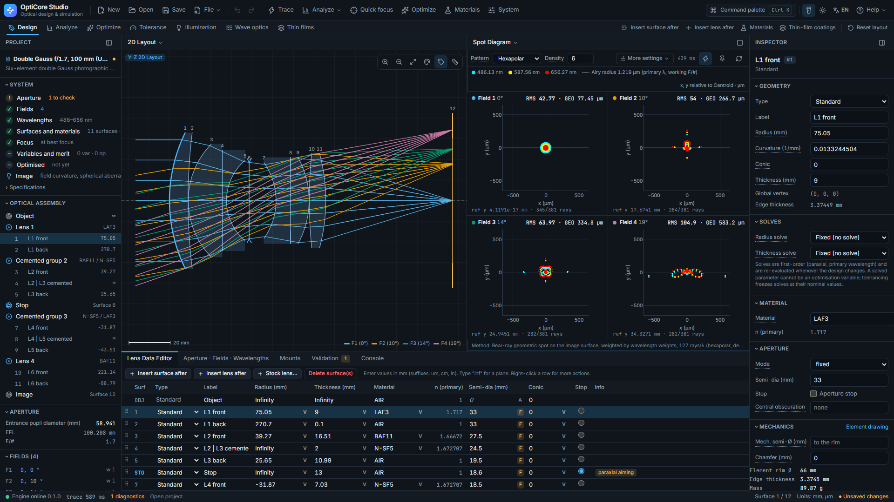
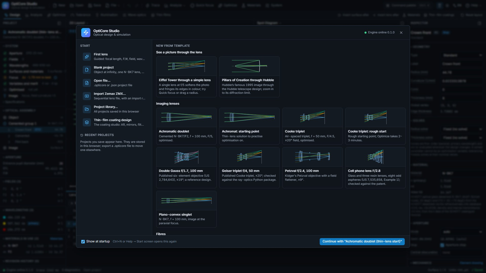

# UI design

## Principles

* **Engineering first.** Every number displayed comes from the engine, with
  method, units and sampling stated. Approximate quantities say so.
* **No dead controls.** Features that are not implemented are documented in
  the roadmap, not shown as disabled UI. Controls that need the engine are
  disabled while it is offline and say so.
* **Live feedback.** Edits re-trace within about 0.1 s; visible analyses
  refresh automatically (can be turned off per view).
* **Never lose work.** Undo/redo for every modelling operation, autosave and
  recovery, revisions on save, and optimisation results applied only on
  request.
* **Calm density.** A compact 12.5 px base size, tabular numerals, muted
  chrome, and a single accent colour for selection and focus.

## Layout

```
┌ Toolbar: logo · New · Open · Save · File ▾ │ undo · redo │ trace · Analyze ▾ · Quick focus · Optimize · materials · system │ palette │ rays · theme · language · Help ▾ ┐
├ Workspace bar: Design · Analyze · Optimize · Tolerance · Illumination · Wave optics ········· context commands · Reset layout ┤
├ Explorer (resizable, Ctrl+B) ┬ Center: two panes, each with a view selector (split/single, drag ratio) ┬ Inspector (Ctrl+I) ┤
│  project, assembly tree,     │  2D layout · 3D model · spot · ray fan · field · longitudinal ·         │  selected surface or     │
│  aperture, fields, λ,        │  chromatic · system data · dispersion                                   │  batch edit              │
│  materials, variables,       ├──────────────────────────────────────────────────────────────────────────┤                         │
│  revisions, saved analyses   │ Dock (Ctrl+J): Lens Data · Aperture/Fields/λ · Merit · Optimization ·   │                         │
│                              │ Validation · Console                                                     │                         │
└ Status bar: engine state · trace time · diagnostics · last action · selection · units · save state ┘
```

### Laptop layout (below 1440 px)

The layout is designed to work at 1366×800 without truncated primary
controls (the acceptance scenario is checked there).

* **Inspector as an overlay.** Below 1440 px the Inspector does not take a
  column: it floats over the analysis area (above the dock, so the Lens Data
  Editor stays fully visible and clickable). Open it with the panel button at
  the right end of the workspace bar or Ctrl+I; close it with Esc, Ctrl+I or
  its close button. From 1440 px it docks as before; the docked setting is
  remembered separately (`lib/viewport.ts`).
* **Lower dock.** A workspace's default dock height is 30 % of the window,
  180–300 px (240 px at 800 px). It cannot be dragged to leave less than
  260 px for the panes.
* **Bottom tabs** that do not fit go into a "+N ▾" menu at the end of the
  strip; the active tab always stays in the strip (`lib/tabOverflow.ts`).
* **Minimum plot sizes.** Spot cells keep at least 180 px and the grid
  scrolls (`lib/plotLayout.ts`); the MTF plot keeps 240 px height and
  scrolls below it. Analysis bars fold (see *Analysis bars*).
* **Lens Data Editor columns** have fixed widths (the table scrolls
  sideways below 1010 px). Headers truncate rather than widen a column; the
  tooltip of every header gives the full name, the unit and what the
  column means.
* **Aperture · Fields · Wavelengths** sizes its label column to the
  longest label, and the wavelength presets are one *Presets…* menu.
* Units are never set inside an `uppercase` heading: CSS turns µm into
  "ΜM" and mm into "MM". Such headings put the unit in a `normal-case`
  span, or leave it to the column headers (a test checks this).

### Toolbar

* **Labels.** The primary commands *New*, *Open*, *Save*, *Analyze*,
  *Quick focus* and *Optimize* show short labels from 1280 px, *File* from
  1360 px, and the rest (trace, materials, system, palette text, workspace,
  help) from 1600–1700 px. Below that they are icons. Every button has an
  accessible name (the full command name, e.g. "Quick focus: move the image
  surface to the smallest RMS spot over all fields and wavelengths") and a
  tooltip with its shortcut. The toolbar never wraps: at 1280 px in Finnish
  about 90 px stay free.
* **File ▾** holds the secondary file commands: *Save as…*, *Import*,
  *Export .opticore*, *Engineering report*, *Export CAD* and *Project info*.
  Menus (`ContextMenu`) take an icon per item and stay inside the window.
* **Icons.** Each command has its own icon (a test checks that no two
  toolbar buttons share one): *Show rays* is a flashlight, CAD export a box.
* **Sequential mode** moved to the status bar. Its tooltip explains that
  non-sequential tracing runs in the Non-Sequential and Ghost views.
* Checkboxes take their accessible name from their label text (`textOf`),
  also when the label is markup.

Panel sizes, visibility, chosen views, theme and language persist per
viewer.

## Workspaces



`lib/workspaces.ts` defines six workspaces; the bar under the toolbar
switches between them instantly.

| Workspace | Bottom tabs | Analysis groups offered | Default panes | Context commands |
|---|---|---|---|---|
| Design | Lens Data, Aperture·Fields·λ, Validation, Console | Layout, Geometric, Image quality, System | 2D layout · spot, Lens Data | insert surface, insert lens, materials, coatings |
| Analyze | + Configurations | + Tools | 2D layout · MTF, Aperture·Fields·λ | re-trace, report |
| Optimize | + Merit Function, Optimization, Configurations | + Tools | 2D layout · spot, Optimization | quick focus |
| Tolerance | + Tolerancing, Merit Function | basic four | 2D layout · spot, Tolerancing | report |
| Illumination | + Sources·Detectors, CAD models | Layout, Illumination and stray light, System, Geometric | 3D model · non-sequential, Sources·Detectors | import CAD, coatings, coating designer |
| Wave optics | + Sources·Detectors | Layout, Beams and wave optics, Image quality, System | 2D layout · POP/BPM, Lens Data | coating designer |

* **What changes.** Each workspace has its bottom tabs (Lens Data, Validation
  and Console are in all), its sidebar sections (e.g. variables and
  optimisation runs only in Optimize and Tolerance, sources in Illumination
  and Wave optics), the analysis groups its view menus list first and a few
  context commands at the right of the bar (existing actions only).
* **Nothing is out of reach.** The view menus end with *More analyses (n)*,
  and a search covers every analysis. A command or link that opens a bottom
  tab the workspace does not have (e.g. *Optimize* in the toolbar, a CAD
  import, *Open Sources · Detectors*) switches to the first workspace that
  has it.
* **Advanced modules stay out of Design**: POP/BPM, fibre modes, FDTD,
  polarisation pupil, non-sequential, ghosts and sweeps are under *More
  analyses* there, and the coating designer buttons in the inspector are
  hidden.
* **Remembered layouts.** Switching stores the panes, views, split, bottom
  tab and height and panel visibility of the workspace being left (panel
  widths are global) and restores those of the next. *Reset layout*
  restores the active workspace's defaults only. Workspace and layouts are
  stored per browser (`opticore.ui`). A layout saved before workspaces
  existed continues in the workspace that has its bottom tab.
* The *Sequential mode* indicator is gone: non-sequential work has its own
  workspace.

The **Help** menu (question mark, right end of the toolbar) holds *Start
screen*, *Keyboard shortcuts*, *Preferences…* and *About & validation*.
*Preferences* sets the theme, the language, *Show at startup* and live
analysis updates; they are stored per browser (`opticore.ui`).

## Analyses: groups, menus and panes

`lib/viewGroups.ts` is the one definition of the analysis views
(`ALL_VIEWS`, from which the `ViewKind` type is derived) and their groups:

| Group | Views |
|---|---|
| Layout | 2D layout, 3D model |
| Geometric | spot, ray fan, OPD fan, field curvature/distortion, longitudinal, chromatic focal shift |
| Image quality | wavefront map, interferogram (fringes, the computed and the phase-shift-recovered wavefront side by side, sampling per pixel), FFT PSF, Huygens PSF, MTF |
| System | system data, dispersion, spectrometer (calibration, linear dispersion, resolution with the grating's mN limit), coatings, polarisation pupil |
| Beams and wave optics | Gaussian beam, POP/BPM, fibre modes (radial profiles, dispersion), fibre cross-section (PCF modes, a job), FDTD (metals; a surface-plasmon source; guided sources show the fitted n_eff + iκ beside the analytic value and the propagation length; the view's body fills its frame and clips, so a short panel never spills over the dock), gratings by RCWA (lines, or crossed gratings and metasurfaces: a periodicity switch, a shape editor under the layer table, a top view of the selected layer, (m, q) order maps) |
| Illumination (detector map) | irradiance W/mm², illuminance lux or true colour (a display choice in the Non-Sequential bar); each source's light (lm, lm/W, colour swatch, x y, CCT) in the sources editor |
| Illumination and stray light | non-sequential, ghosts |
| Tools | parameter sweep |

* **Pane selector.** Each pane header shows its view's name with a chevron.
  It opens `ViewMenu`: a search field over a grouped list with the current
  view ticked and the Ctrl+n shortcut of the first nine views. ↑/↓ and Enter
  pick, Esc closes. Search matches every typed word against the view name and
  its group name.
* **Analyze** in the toolbar opens the same menu for the focused pane.
  The popover is clamped to the window and scrolls inside, so it never runs
  off a 1366×800 screen.
* **Palette.** Views are listed as *Group › View* and also match the word
  *Analyze*.
* **Focused pane.** A click in a pane focuses it (thin accent ring). Views
  picked from the Analyze menu, the palette, Ctrl+1…9 or links in other
  panels (e.g. *Open the Non-Sequential view*) open in the focused pane. A
  view already on screen is only focused, never shown twice. When the
  workspace is split, the right pane has the focus at start, so the first
  analysis does not replace the layout.

## System card (setup checklist and specifications)

`components/panels/SystemCard.tsx`, at the top of the sidebar in every
workspace. Each row has a status (✓ done, ! needs attention, red ! error,
– not set up), a short detail and a tooltip; a click opens its editor.

| Item | Status from | Click opens |
|---|---|---|
| Aperture | engine diagnostics ZERO_APERTURE, TELECENTRIC_EP/STOP, CB_BEFORE_STOP | Aperture · Fields · λ |
| Fields (n) | RAY_FAILED, FIELD_AFOCAL, FIELD_SCALE, FIELD_UNREACHABLE | Aperture · Fields · λ |
| Wavelengths (n) | WAVELENGTH_EXTRAPOLATED, COATING_RANGE | Aperture · Fields · λ |
| Surfaces and materials | every other warning or error; a failed evaluation | Validation (with the surface selected) or Lens Data |
| Focus | `/analysis/focus`: the image surface is within 5 % (0.1 µm) of the best polychromatic RMS focus; otherwise "best focus Δz mm away" and a crosshair that runs Quick focus | Lens Data, image distance selected |
| Variables and merit | enabled variables and operands (both ✓, one !) | Lens Data / Merit Function / Optimization |
| Optimised | an applied optimisation run; ! when the merit function (engine) has grown more than 1 % since | Optimization |

*Specifications* (collapsed until a target exists) compares targets with the
engine's current values: EFL and image-space F/# (paraxial, primary λ) with
a ± tolerance, RMS spot (largest field RMS from the focus analysis) and total
track (paraxial) with an upper limit. Targets are stored in
`analysis_settings.specs` (no schema change) and every edit is one undoable
step. The grouping of diagnostic codes and the comparisons live in
`lib/checklist.ts`; no optical quantity is computed in the UI.

## Messages: causes and fixes

The *Validation* tab (`MessagesPanel`, non-modal; the status-bar count opens
it) lists the engine's diagnostics, errors first, with filters *All /
Errors / Warnings / Notes*. Each message shows:
* the **cause** in plain language (`dg.<CODE>.cause`; ray failures are told
  apart by the engine's status: missed surface, total internal reflection,
  clipped, outside the surface domain, no convergence, evanescent order);
* the **fix** (`dg.<CODE>.fix`);
* the engine's own message, the surface and the code, small and muted;
* **fix actions**: *Go to surface n* (selects it and opens the Lens Data
  Editor), *Aperture · Fields · λ*, *Material library*, *Coatings*,
  *Configurations* or *Lens Data Editor*, as fits the code
  (`lib/diagnostics.ts`). A click on the message selects its surface.

When the system cannot be traced, the error and its diagnostics are shown
the same way. Coverage: `python -m opticore.tools.diagnostic_codes --write`
lists every code the engine can emit (static scan) in
`frontend/src/lib/__fixtures__/diagnostic_codes.json`; a backend test keeps
the list current and a frontend test requires a cause, a fix and actions for
every code in English and Finnish.

## Optimisation wizard

`components/dialogs/OptWizard.tsx` (logic in `lib/optWizard.ts`). Opened
from the Optimize workspace bar (*Wizard*), the Optimization and Merit
Function tabs, the empty states (no variables), the sidebar, the System
card (*Variables and merit* when nothing is set up) and the palette.

* **What may change**: radii (plane surfaces stay plane unless unticked),
  air gaps, glass thicknesses, image distance; counts are shown. Coordinate
  breaks, ideal lenses and values driven by a solve are never variables.
* **Goal** (ADR-039). Each choice has a one-line explanation:
  * *Sharpest image: RMS spot* or *RMS wavefront error*, over all fields
    and wavelengths, relative to the centroid or the chief ray. The
    wavefront is polychromatic, so colour counts.
  * *A spot of a given size*: RMS radius in µm, e.g. a defocused beam on a
    sensor.
  * *A beam of a given diameter on a detector*: D4σ in µm, with the
    detector chosen. This uses the project's light sources and detectors,
    with the power on the detector kept up at weight 0.1. It is disabled,
    with the reason, when the project has no enabled source and detector.

  The field and wavelength weights stay editable in place (they are the
  system's weights).
* **Constraints**:
  * The defaults scale with the smallest lens and are never stricter than
    the design is now (OPTICAL_ENGINE, *Optimisation wizard defaults*).
  * Each row shows what the design has now (*now 0.86 mm*).
  * Lens centre thickness ≥ / ≤ are hard bounds of the thickness variables.
  * Lens edge thickness becomes *min edge thickness* operands; plane-parallel
    plates get none.
  * *Air gaps between lenses ≥* is an edge target and a hard bound at the
    centre of lens-to-lens gaps.
  * *Keep the focal length at* adds an EFL target, prefilled with the
    engine's current EFL.
  * *Distortion at most* (%): on by default for off-axis systems, at the
    current |distortion| (engine) rounded up.
  * *Total track at most* (mm): offered with the current value.
  * The focal length and distortion limits apply by default only to the
    sharpest-image goals. A spot or beam of a given size is set by the power
    and the focus, so for those goals both are off unless the user ticks them.
  * The beam goal shows an amber note when the chosen detector is not anchored
    to the image surface (the image distance then does not move it).
  * *Lateral colour at most* (µm), *Corner illumination at least* (%) and
    *Chief-ray angle at most* (°) show the engine's current values (one
    `/analysis/summary` call when the dialog opens). Lateral colour is on by
    default for the sharpest-image goals.
* **Existing set-up**: replace the current variables and operands, or add to
  them without duplicates.

*Create and open Optimize* applies everything (weights, variables,
operands) as one undoable step and opens the Optimization tab. The LDE "V"
toggles remain for finer control. Variable bounds come from the same
`defaultBounds` as the V toggles.

### Watching and comparing a run

* While a run lasts, every view follows the best solution so far (the
  engine store's preview). The layouts show *Live preview of the best
  solution so far*, and each analysis frame shows a *Preview* badge, so the
  live image sharpens as the optimiser works.
* After the run the result **stays on screen** until it is applied or
  discarded. The badges then read *Optimised result, not applied yet* and
  *Optimised · not applied*. Before this change the views fell back to the
  starting design the moment the run finished, which looked as if the
  optimisation had done nothing.
* *Show the result in the views* (next to *Apply as new revision*) switches
  every view between the optimised and the original design for comparison.
* An edit of the design while a result waits shows the edited design. The
  result can still be applied to it: only the optimised variables are
  written. *Apply*, *Save as new project* and *Discard* end the preview.

### Is the image better? (ADR-039)

The merit function holds the constraints too, so its improvement alone can
mislead.

* The result's headline shows the status (localised; *stopped by an error*
  when the search ended on an error and the best design so far is kept).
* Next to MF *before → after* it shows each image-quality operand (RMS spot,
  RMS wavefront, MTF, beam diameter) before → after, green when closer to
  its target and amber when worse.
* Amber notes:
  * an image-quality operand got worse while the merit function improved
    (`objective_worse`): constraints outweigh it;
  * a share of the final merit function comes from targets no variable can
    change (`fixed_operands`), listed with value and target;
  * some variables did not change the merit function at all
    (`inert_variables`), with the likely cause.
* **Image and system, before / after** (`/optimize/compare`, rows in
  `lib/optCompare.ts`). The rows are:
  * the RMS spot and MTF (T / S, at the engine's comparison frequency) per
    field;
  * distortion, lateral and axial colour, relative illumination and the
    chief-ray angle at the largest field;
  * the object field of the largest field (the field of view), EFL and total
    track;
  * the thinnest lens edge and air gap.

  A summary line says *Worse: distortion, lateral colour, …* (amber), or
  *Nothing in this table got worse* (green), plus *Changed: field of view*.
  Worse rows are amber, and the thresholds are the engine's. This table
  replaced the RMS-spot-only table.
* The Merit Function tab marks an operand no variable can change with a
  *fixed* badge, whose tooltip says why and what to do. Its *Options* column
  holds the reference (centroid or chief ray) of the spot and wavefront
  operands, the MTF frequency and direction, and the beam-diameter axis. The
  footnote explains targets above 0 and why units decide the balance.
* While a run lasts, the views follow the best design at most every 1.5 s:
  each preview makes them recompute in the engine. The result line names the
  worker processes that computed the Jacobian.
* **Live image: sensor pixels.** A *1 px = … µm* choice (the system's sensor
  model ★, or 1.0–5.5 µm) zooms so that one image pixel is one sensor pixel
  (`lib/liveZoom.ts`). It shows the sharpness that camera would record, which
  the whole frame at the view's 14.6 µm pixels cannot. It keeps that scale
  when the resolution changes, and choosing a fixed zoom leaves it.
* **Exact limits** (ADR-042):
  * The Merit Function toolbar has *Limits: exact / weighted* (exact by
    default). Its tooltip explains both.
  * A *Role* column offers *Auto: Goal* or *Auto: Limit* (by type), *Goal* or
    *Limit*. With weighted limits every row is a goal.
  * A limit's weight shows "—" with a tooltip, since it is not used. Its
    contribution cell shows *✓ met* or *✗ not met*.
  * The toolbar shows *n/m limits met* and *Merit (goals)*.
* **Limits of a result.** Above the before/after tables, *Limits* lists each
  limit with its target (= / ≤ / ≥), before, after and ✓/✗.
  * *If relaxed to* shows the price: the relaxed value and the merit change it
    predicts, e.g. *1.8 → MF −2.8 %*. It is marked ≈ when the design is not
    yet a constrained optimum, and shows *not limiting* for a limit with
    slack.
  * The progress strip gains *Limits met n/m*, and an `infeasible` status is a
    red badge.
* **Trade-off curve.** *Curve* on an active limit opens a dialog
  (`TradeoffDialog.tsx`). It re-optimises that limit at nine values on all
  processor cores and plots the best merit against it. The result's own point
  is a star and its price the dashed tangent; limits not met are crosses.
  * Its table lists each point's merit, change, ✓/✗ and evaluations.
  * *Show* makes a point the result: it is compared, then applied as a new
    revision or discarded like any result.
  * Closing the dialog cancels the curve.
* **RMS spot across the field.** Above the comparison table, a chart shows the
  RMS spot from the axis to the largest field, before (dotted) and after. The
  system's fields are dots. A sampling gap (the image falls apart between the
  fields the merit function sees) is marked with a cross, with an amber note
  that suggests adding a field there.
* **Quick focus** reports the RMS spot per field before → after in its toast
  and the console. When a field got worse (more than 20 % and 0.5 µm) the
  toast is a warning that names it and suggests raising its field weight:
  Quick focus minimises the field-weighted mean (`lib/focusReport.ts`).
  * Its result is applied only to the design it was computed for. If another
    project was opened or the design edited while it ran, a warning says so
    and nothing changes.
  * An image distance set per configuration (a row in the configuration
    editor) is focused in the active configuration, and the result goes to
    that row (`lib/quickFocus.ts`).

## Start screen



`components/start/StartScreen.tsx` opens at launch (on for a first run) and
from *New* (Ctrl+N), Help → *Start screen* and the palette. It is an overlay on
the workspace: the project that was open last is already loaded behind it, so
Esc, the close button or *Continue with "name"* go straight to work.

```
┌ logo · OptiCore Studio · engine state ─────────────────────────────── × ┐
├ Start                          ┬ New from template                       ┤
│  Blank project                 │  Imaging lenses                         │
│  Open file… (.opticore/.json)  │   [thumb][thumb][thumb][thumb]          │
│  Import Zemax ZMX…             │  Fibres                                 │
│  Project library…              │   [thumb][thumb][thumb]                 │
│ ┌ Unsaved work ─────────────┐  │  Mirrors and folded systems             │
│ │ Continue · Discard changes│  │   [thumb][thumb]                        │
│ └───────────────────────────┘  │  Multi-configuration                    │
│  Recent projects (6, thumbs)   │   [thumb]                               │
├ ☑ Show at startup · Ctrl+N hint ─────────── Continue with "name" ┤
└──────────────────────────────────────────────────────────────────────────┘
```

* **First lens** (first action; also in the palette) opens a three-step
  guide (`FirstLensDialog`): (1) focal length, F/# (the entrance pupil
  diameter is shown) and half field angle; (2) a wavelength preset (F, d, C;
  five visible; He-Ne); (3) singlet or cemented doublet and the glasses
  (crown and flint from the material library; the doublet needs more than
  one wavelength). *Create lens* asks the engine (`/design/first-lens`) for
  the starting prescription, opens it unsaved in **Design** with the 2D
  layout and the spot diagram, runs Quick focus and shows a one-line hint
  *Next: optimise* with an *Optimize ›* link in the workspace bar (it goes
  away in Optimize or with ×). The project already has variables and a
  merit function, so *Optimize* runs at once.
* **Templates.** Cards are grouped by the engine's sample category (imaging,
  fibre, mirrors, multiconfig) in that fixed order. Each card has a lens
  profile thumbnail, a translated name and a one-line purpose
  (`tpl.<id>.name/.purpose`; samples without a translation fall back to the
  engine's name and description, which is also the card tooltip).
* **Thumbnails** are drawn by `OutlineThumb` from the engine's outline
  (`/samples` includes it; `/system/outline` for saved projects): exact
  meridional profiles, glass outlines, mirrors, stop blades, the image plane
  and the marginal/chief rays of up to three fields at the primary
  wavelength, coloured by field. They are drawing data, not results.
* **Recent projects** lists the six most recently saved projects in this
  browser with their thumbnail, age and surface count; *All n…* opens the
  project library.
* **Unsaved work.** If the last session ended with unsaved changes, that work
  is reopened as the open project (still unsaved) and the start screen shows
  an *Unsaved work* card, even when *Show at startup* is off. *Continue* keeps
  it; *Discard changes* reopens the saved version of that project (or the most
  recent saved project, else the tutorial sample). Picking anything else goes
  through the usual unsaved-changes confirmation. This replaces the former
  modal recovery dialog.
* **Show at startup** (also in Preferences). Unticked, a reload opens the last
  open project directly.
* **Offline engine.** Templates and ZMX import need the engine: the template
  area says so and fills in by itself when the engine comes up. Blank
  projects, project files and saved projects still open.

## Design tokens

Defined in `src/index.css` (`@theme` and `:root`) and enforced by
`src/lib/designTokens.test.ts`.

* **Fonts.** Inter and JetBrains Mono are bundled (`@fontsource-variable/*`,
  OFL, imported in `main.tsx`), so Windows, macOS and Linux render the same
  type. Monospace (`.num`) is for numbers in tables and readouts; the whole
  UI uses tabular numerals (`font-variant-numeric: tabular-nums` on `body`).
* **Type scale.** Four sizes:

  | Utility | Size | Use |
  |---|---|---|
  | `text-caption` | 10.5 px | badges, footnotes, method lines, keyboard hints |
  | `text-small` | 11.5 px | secondary labels, table headers, dense rows, numbers (`.num`) |
  | `text-body` | 12.5 px | default text, inputs, menus |
  | `text-title` | 14 px | dialog and card titles |

  No `text-[Npx]` classes remain (test).
* **Controls.** Two heights: 28 px (`h-7`, buttons, inputs, toolbar) and
  24 px (`h-6`, dense bars and small buttons). `.field-input` defaults to
  28 px; component classes sit in `@layer components`, so utilities such as
  `h-6` or `text-small` refine them. List rows are 24 px. No arbitrary
  `h-[Npx]` remains (test); larger layout sizes use the spacing scale
  (`h-50` = 200 px).
* **Spacing and shape.** A 4/8 px grid (Tailwind spacing units). Icons are
  12, 14 or 16 px (test; 18 px and up only for illustrations). Radii are
  4 px (`rounded`), 6 px (`rounded-md`: buttons, inputs) and 8 px
  (`rounded-lg`: cards, menus, dialogs).
* **Text contrast** (WCAG AA, checked for both themes by
  `src/lib/palette.test.ts`):

  | Token | Role | Contrast |
  |---|---|---|
  | `text` | primary text | ≥ 4.5:1 everywhere |
  | `muted` | labels, secondary text | ≥ 4.5:1 everywhere, also on hovered and selected rows |
  | `faint` | units, captions, timings | ≥ 4.5:1 on the resting surfaces (panel, panel-2, elevated, input); on a selection tint it is drawn as `muted` |
  | `accent`, `ok`, `warn`, `danger` | links, status text | ≥ 4.5:1 on the resting surfaces |
  | white on `accent-strong` | primary buttons, active toggles | ≥ 4.5:1 |

  The steps between `text`, `muted` and `faint` stay visible (test). Data
  colours (`--d-*`) are for marks and lines (≥ 3:1); text is never set in
  a data colour: a field heading is ordinary text with a coloured swatch
  (test).
* **Theme switching.** The `data-theme` attribute is set in a layout
  effect, before any child effect runs, so plots and the 3D scene that read
  the tokens redraw in the new theme's colours. Plots force a recalculation
  on every redraw (`datarevision`), so a language switch that only renames
  traces and titles keeps the axis ranges.

## Components

| Component | File |
|---|---|
| Design tokens (CSS variables for dark/light), engineering table and input styles | `src/index.css` |
| Primitives: Button, IconButton, Tooltip, Dialog, NumberField, TextField, Select, Checkbox, Tabs, Section, Field, Badge, ContextMenu | `components/common/ui.tsx` |
| Analysis controls: Label, Row, Stat, FieldSelect, WavelengthSelect, MoreSettings | `components/common/controls.tsx` |
| Analysis settings stored in the project (undoable) | `components/common/useAnalysisSettings.ts` |
| Plotly wrapper (themed, resize-aware, equal-aspect option, no cloud sharing) | `components/common/Plot.tsx` |
| Views | `components/views/*` |
| Editors (Lens Data, System, Merit, Optimization, Tolerancing) | `components/editors/*` |
| Panels | `components/panels/*` |
| Dialogs | `components/dialogs/*` |

### Buttons

* `Button` variants: *primary* (one per context: Run, Apply, Optimize),
  *default*, *ghost*, *subtle*, *danger* and *link* (an inline text action:
  "Edit coating…", "Report", "All projects").
* `IconButton` is an icon-only button named by its `title` (tooltip and
  accessible name, always translated). `size="sm"` is the 20 px row action
  of tables and lists (remove, edit, show/hide, expand); it uses the native
  tooltip so layout classes such as `ml-auto` or
  `invisible group-hover:visible` apply to the button itself.
  `tone="danger"` colours remove/delete on hover.
* A bare `<button>` is kept only for composite widgets: tabs, list and tree
  rows, menu options, radio cards and the toolbar's labelled commands. A
  test rejects bare styled row actions and English literal `aria-label`s.

### Analysis bars

Every analysis view has one bar (`AnalysisFrame`): its few primary
settings, then *More settings ▾*, then the timing, the live toggle, pin
and refresh (or the run controls of an on-demand analysis such as FDTD).

* **Primary** settings are those changed while looking at the result:
  field, wavelength, the sampling that sets the speed (spot pattern and
  density, fan samples), the source and wavelength of POP, the example of
  FDTD. **Secondary** ones (reference, log scales, grid and padding, maximum
  frequency, POP method and view, ray counts and seeds, cladding, …) sit in
  the *More settings* popover, one labelled row each.
* **Labels** come from `Label`: with a hint they get a dotted underline and
  a help cursor, the visible sign that hovering explains them. Units go in
  the label or column header (`a (µm)`, `Max frequency (cyc/mm)`,
  `Ghost focus (mm)`), never only in a tooltip.
* **The bar never wraps.** Controls keep their width (they do not squeeze
  into truncated selects). When a narrow pane (a split view on a laptop)
  cannot hold them, the primary settings fold into the popover, which is
  then called *Settings*; they come back once the pane is 48 px wider than
  they need (`lib/barFold.ts`, so the bar cannot flap). Below a 36 rem pane
  the popover trigger shows only its icon and the timing hides.
* Field and wavelength pickers are the shared `FieldSelect` /
  `WavelengthSelect` (values with units, *Primary λ* first).
* Settings are stored in the project with `useAnalysisSettings(key,
  defaults)`; each change is one undoable step and is saved with the project.

### Engineering input (`NumberField`)

* Commits on Enter or blur (exactly once); Esc cancels.
* Invalid input stays visible, outlined red, with the reason in a tooltip.
* Unit suffixes: lengths `nm um µm mm cm m in`, wavelengths `nm um mm`.
* `inf` / `Infinity` / `∞` is accepted only where meaningful (radius, object
  distance).

### Dialogs

`Dialog` closes on Escape, a backdrop click or its close button. A dialog that
must not be dismissed by accident is created with `dismissable={false}`, which
removes all three, so the user has to choose explicitly. Autosave stays off
until the launch has read the previous autosave and opened a project, so
recoverable work is never overwritten before it is offered.

### Confirmations

`window.confirm` is not used. `store/confirmStore.ts` holds one question at a
time and `ConfirmHost` renders it above every dialog (`role="alertdialog"`).
Esc, × and a backdrop click cancel; while it is open, the dialogs underneath
and the keyboard shortcuts ignore keys (`isConfirmOpen`).

* **Unsaved changes** (`confirmDiscard`, before New, a template, a recent or
  library project, or a file replaces the open project): *Save* (focused),
  *Don't save*, *Cancel*. *Save* saves to the browser library first; if that
  fails, the project stays open.
* **Deletes** name what is deleted ("Delete project "A" from this
  browser?") and start with the focus on *Cancel*, so Enter does not delete.

### 2D layout framing

`lib/framing.ts`. The layout fits the system (rays from an object at
infinity included) when a project is opened, on first display and when the
pane is resized. After that it refits by itself only when part of the
system leaves the view or the system shrinks to less than a third of it.
Zooming (wheel, buttons) or panning (a drag of more than 3 px) turns
automatic framing off until the next project or *Fit to view*
(double-click).

### Empty and error states

Every empty state says why and offers the next step:
* **Offline engine** (`OfflineNotice`): what still works (editing, saving,
  exporting) and that the view updates by itself; the commands to start
  the engine are folded under *For developers*.
* **Analyses** without a result: *Tracing / Computing…* while running; an
  error shows the engine message, a hint and *Try again*; with live update
  off, *Compute now*.
* **Merit function** empty: *Add RMS spot size*. **Optimization** without
  variables: *Optimisation wizard…*, the Lens Data Editor and the Merit
  Function tab. **Sidebar**: no variables → *Optimisation wizard…*; no sources →
  *Open Sources · Detectors*; no revisions → *Save now*.
* `Empty` centres its content with `m-auto`, so tall content scrolls instead
  of being cut off at the top.

### Names instead of ids

The inspector shows the surface type under the title (not the internal
id). Optimisation variables are named by `lib/paramLabels.ts` (*Curvature*,
*r⁴ coefficient*, *Coating layer 2* …) in the inspector, the sidebar, the
merit function's variable table and the optimisation results.

### Coating editor

`CoatingEditor` (command palette, or "Edit coatings…" in the inspector's
coating section) lists project coatings and the built-in library, grouped by
category (antireflection, mirrors, filters, beam splitters), with a search
box. Built-ins are read-only; Duplicate copies one into an editable draft.

* A built-in's header shows its design wavelength, band, angle, the media it
  was designed for, and its specification. Its layers carry material labels
  (TiO₂, SiO₂ …) and a Σ row with the total thickness.
* *Designer* opens the selected coating in the coating designer. A built-in
  opens under its design conditions with its specification as the targets.
* The draft is edited locally and committed as one undoable step with
  "Save to project". Renaming also renames surface references.
* A coating used on a surface cannot be deleted.
* **Analyses** (`CoatingAnalysisPanel`, shared with the designer; engine
  `/coatings/analyze`):
  - The toolbar sets the wavelength range, angle of incidence, further
    angles, reference wavelength and band. Next to it are the incident
    index n₀, the substrate (fixed n or a library glass), the incoherent
    back surface, and the coating's own metal substrate for a mirror.
  - Tabs: *Spectrum* (%, log % or optical density, s/p, A, read-outs at
    λref, band statistics, Rv/Tv), *Angle*, *Phase · GDD* (phase, GD, GDD
    or ψ/Δ of reflection or transmission), *Colour* (swatches, x y,
    L*a*b*), *Field* (|E|² over the index profile, s or p, absorptance per
    layer), *Profile* (n, k, thickness, QWOT).
  - The defaults come from a built-in's band and design wavelength.
* The "n·d/λ₀" column and the λ/4 button are unit conversions of the
  entered values, not optical results.

### Coating designer (workspace *Thin films*)

The coating designer is the centre of the *Thin films* workspace
(`CoatingStudio`, ADR-054). Every entry point switches to it: the command
palette, the editor's ✦ and *Designer* buttons, *Design…* in the inspector
and the Coatings view, and the start screen's *Thin-film coating design*
action and coating cards. A library rail (toggle in the designer's header)
lists project coatings, worked examples (published benchmark problems
designed with the designer, with their merit; ADR-056), the system's surfaces
with their coatings, and the built-in library by category. Opening an example
replaces the working design in one undo step and shows the spectrum at its
first target's angle. From 1600 px it sits beside the designer and
starts open; on narrower windows it floats over the designer and closes after
a pick (or Esc). Sidebar,
inspector and bottom panel start closed and stay a toggle away.

The designer is a three-column workspace:
* **Left:** setup, palette, start design and targets.
* **Centre:** tabs for
  - the spectrum with R/T/A target overlays (s/p shows Ts, Tp, Rs and Rp)
    and the index profile;
  - *Targets*: every target with what the design achieves, and plots of
    the GD, GDD, phase and retardance targets against their band;
  - angle curves;
  - *Analyses*: the coating editor's phase · GDD, admittance, colour,
    field, profile, spectrum and angle tabs for the working design;
  - *Measurement fit*: paste or import a measured spectrum, then fit:
    - thickness (a common scale, every layer, both or none);
    - film indices (Δn), dispersion (ΔB/λ²), absorption (k) and the
      substrate index;
    - with a local or a global search.

    *Apply* takes the as-built thicknesses and index corrections in one undo
    step. Fitted corrections show under each palette material (Δn, ΔB).
  - thickness errors (Monte Carlo) and the deposition recipe.
* **Targets** (left column): quantity R, T, A, GD, GDD, φ, Δ, Rv, Tv, L*,
  a*, b*; reflected or transmitted (`of`) where it applies; values in the
  quantity's units (fractions in %).
  - The file button of a spectral target imports a tabulated target curve
    (text or CSV, wavelength in nm and value per line; values above 1 of a
    fraction are read as %). A tabulated target shows its number of points
    and band, with *remove table*; its value and sample-count fields give
    way to the table. Polarised R/T/A targets switch the spectrum's s/p
    curves on.
* **Layers** (right column): a *Formula* field above the table shows the
  design in Macleod's notation. Entering a formula replaces the layers in
  one undo step.
* **Right:** layers in deposition order, plus *Refine* and *Needle*.

The working design is stored in `analysis_settings.coating_design`, so it
is saved with the project. Every edit and every optimisation result is one
undoable step. Exports are generated in the browser from the engine's
recipe.

**Designs and coatings:**
* The *Design* selector opens any project coating's stored design, or
  rebuilds one from a coating that has only layers.
* *Update* replaces that coating (all surfaces using it follow); *Save as
  new* creates another.
* *Design…* in the inspector, the batch inspector or the Coatings view
  opens the designer for the selected surface(s), with their media, real
  ray angles and band. Saving then assigns the coating to them.
* *Keep current targets* lets a template replace only the layers.
* Back side: none, an uncoated back face, or a coated back face (its layers
  as a formula, or "= front"). With a substrate thickness the plate's
  absorption and group delay are included.
* Library materials include measured films (`*_FILM`) and metals. Metals
  are offered as substrates and layers, not as incident media or lens
  glasses. The material browser plots k beside n.
* Colour targets choose their illuminant and observer. The analyses' Colour
  tab has the same choice, and the Field tab a λ × depth map.
* The incident medium can be a library material or a fixed index n₀
  (*Fixed n…*, e.g. the glass of a cube beam splitter); the substrate a
  library glass or a fixed N = n − ik (*Fixed n, k…*: a glass at its design
  index or a metal).

### Material library and glass catalogues

* **AGF import.** The AGF button imports a manufacturer catalogue. The
  import report opens and lists counts, comments, flagged glasses and
  skipped entries. Catalogues are listed under the table with their size,
  date, *Report* and remove buttons.
* **Makers.** The *Makers* button opens the installer in the detail pane.
  It lists the makers of the refractiveindex.info database with their glass
  counts, shelves and installed state (SCHOTT, OHARA, HOYA, CDGM, HIKARI and
  SUMITA preselected). It downloads the chosen ones with a progress bar and
  a cancel button, and reports glasses, flagged glasses and failed pages per
  maker. A note warns when an installed catalogue of the same name will be
  replaced.
* **Filters.** The source filter offers all sources, built-in, this project,
  or one catalogue. The status filter offers all glasses, hide obsolete
  (default), or preferred only. A picked glass always stays visible.
* **Rows.** Status badges show preferred or obsolete; a warning icon marks a
  glass that fails the Nd/Vd self-check.
* **Glass map.** The nd–Vd map colours preferred glasses green and obsolete
  ones grey, and highlights picked glasses.
* **Glass card.** With one glass picked, the card shows catalogue, status,
  MIL code, catalogue nd/Vd with the deviation, density, expansion, ΔPg,F,
  relative cost, dn/dT model and the internal-transmittance table.
* **Assigning.** Assigning a catalogue glass (from the library, the material
  cell or glass substitution) copies its definition into the project, in the
  same undoable step.
* **Glass-substitution candidates.** The candidate dialog filters by source,
  text and obsolete status. *Add nearest N* selects the N glasses closest to
  the current glass on the nd–Vd map (1 Abbe unit counts like 0.01 in nd),
  skipping flagged glasses.

### Temperature and pressure (environment model)

* **Settings.** *Aperture · Fields · Wavelengths* tab, *Environment*
  section: *Model temperature and pressure* (off by default), temperature
  (°C), pressure (atm, 0 = vacuum) and the housing (aluminium 6061, stainless
  304, brass, titanium, Invar or a custom CTE). The System card gets an
  *Environment* row (temperature · pressure) while the model is on; thermal
  diagnostics (missing data, temperature outside the data range) belong to
  that row.
* **Per gap and mirror.** Inspector, *Mounting (thermal)*: the expansion of
  the spacer after an air gap or of a mirror substrate; empty = the housing
  (shown as the placeholder). It is also an optimisation variable
  (*Spacer/substrate expansion*) for passive athermalisation.
* **Per configuration.** Temperature and pressure are system rows in the
  configuration editor; adding one turns the model on in the same step.
* **Analysis.** *Temperature & Pressure* in the *System* group: swept
  quantity and range in the bar, points and pupil density under *More
  settings*; read-outs (focus shift per kelvin, focus spread, diffraction
  depth of focus, EFL change per kelvin, the system's own condition), a
  one-line verdict against the depth of focus, and plots of best focus
  (with the depth-of-focus band), RMS spot (on the image surface and at
  best focus) and EFL change.
* **Materials.** The material editor has *Thermal data*: CTE and the Schott
  dn/dT coefficients, so glasses without catalogue data can be completed in
  the project.
* **Mounts.** Bottom tab *Mounts* (Design and Analyze workspaces; the badge
  counts the parts). With the model off it shows one sentence and *Turn on
  the environment model*.
  * *Parts* table: name, material preset (sets the CTE) or a custom CTE, an
    optional own temperature (placeholder: the system temperature),
    *Attached to* (the fixed reference or a part; parts that would make a
    cycle are not offered), datum z, the linked CAD part, and the datum
    displacement (µm) at the current condition. With a CAD part linked, two
    small buttons put the datum at the part's front or back.
  * *Seats* table: every surface that can be seated, *Held by*, its nominal
    z and its displacement (µm).
  * *Element temperatures* table: one optional temperature per lens element.
  * Mount diagnostics are shown under the tables; they also go to the
    *Environment* row of the System card, whose fix opens this tab.
* **Inspector.** *Mounting (thermal)* also has *Held by* and, on the first
  surface of an element, *Element T*. When the mounts set a gap (the next
  element is seated), its spacer expansion is shown disabled as *set by the
  mounts* and is not offered as a variable.
* **Temperature analysis.** The depth-of-focus band is centred on the best
  focus at the system's own condition, so it shows how far the thermal
  focus shift may go.

### Tolerancing (Tolerance workspace)

* **Bar.** Criterion (RMS spot, RMS wavefront, merit function or MTF; with
  MTF its frequency), the specification *Spec ≤* (*≥* for MTF, empty = none)
  and the Monte Carlo trials; *More settings* holds the pupil rings, the
  distribution, the seed, the fringe test wavelength (546.07 nm) and the
  compensator evaluations. Below: *Run analysis*, *Allocate to spec*
  (disabled until a specification is set; its tooltip explains), the grade
  and *Defaults*.
* **Tolerance table.** Type, surface (only the surfaces the type applies
  to), *To surface / term* (the group end of element tolerances, the Fringe
  term of a Zernike form tolerance with its name), min, max, unit (mm, °, µm,
  fr) and two row actions: the lock (*Keep this limit when allocating*) and
  remove. Changing the type keeps the surface where it applies and resets the
  limits when the unit changes.
* **Results.** Read-outs: nominal, RSS estimate, MC mean, the 90 % and 98 %
  levels on the side that matters (*90 % of trials ≤* / *≥*) and, with a
  specification, the yield with its 95 % interval. The histogram marks the
  nominal (dotted) and the specification (dashed).
* **Allocation.** After *Allocate to spec*: one sentence on the budget and
  the predicted value with all tolerances at their limits, then a table of
  each tolerance with its surface number, current and allocated limits,
  factor (or a badge: locked, insensitive ×10, cannot tighten enough) and
  share. *Apply allocated limits* writes them into the tolerance list as one
  undoable edit; it is disabled once the design or the tolerances have
  changed since the run.
* **Limits** (criterion *merit* with exact limits, ADR-043): a table above
  the sensitivity table lists each limit with its target, its nominal value
  (red when missed) and how many Monte Carlo trials meet it ("n/m", amber
  when some miss), with its p10 … p90 range. The criterion is then the
  goals' merit, as in the optimiser, and the limits do not enter the yield.
* The optimisation status *stopped before converging* (amber) marks a run
  with exact limits that reached its outer-iteration limit with budget left.
* Ray fans of a field off the y axis are labelled e_T(P_T) and e_S(P_S)
  (tangential along the field, sagittal across it); fields along y keep
  e_y(P_y) and e_x(P_x).

### Odd aspheres

* Surface type *Odd asphere* in the LDE and the Inspector. The Inspector's
  *Odd-asphere terms* section adds β₁, β₂, … one at a time, labelled with
  their power of r, and removes from the end. The LDE shows a badge r<N>, and
  the variables are named *Odd asphere r<i>*. The 2D and 3D views draw the
  exact sag, and the element drawing names the surface type.

### Central obscuration

* Inspector, *Aperture*: *Central obscuration (mm)*, the radius of a central
  circular obscuration on the surface (empty means none). Ray failures it
  causes are explained as *blocked by central obscuration*.

### Vignetting factors

* The fields table (*Aperture · Fields · Wavelengths*) has *Set vignetting*,
  which computes every field's factors from the fixed apertures in one
  undoable edit, and *Clear*. While any factor is set, the VDX, VDY, VCX and
  VCY columns are shown and can be edited; the table scrolls sideways on
  narrow screens. A toast names any field whose centre ray is blocked.

### Design advisor

* *Design advisor* is the first view of the System group, so every
  workspace offers it. Two columns when the pane is wide enough, one below
  that.
* **What limits the image**: one sentence per finding, built from the
  engine's numbers (`findingText`), with a warning dot or a green one for
  *diffraction limited*. Below each, *Causes* chips name the surfaces with
  their share of the third-order sum; a click selects the surface (layout,
  LDE and Inspector follow).
* **Wavefront by field**: a stacked bar per field of the class shares
  (defocus grey, the blur classes in the data palette, the residual in the
  reference colour), the RMS wavefront in waves with a *diffraction limited*
  badge, and the RMS spot. A legend and the Airy radius below.
* **Suggestions**: *Find improvements* starts the engine job (progress bar,
  *Cancel*). Each suggestion shows the move in words, the merit gain as a
  bar and a percentage (tooltip: merit before → after), the changed values
  (old → new) and the RMS spot per field before → after. *Apply* makes one
  undoable edit (*Advisor: …*) and starts the next search; results are
  kept per design, so *Undo* brings the earlier list back at once.
* **System card**: a row *Image* lists what limits the image (the first two
  findings, then +n) and opens the advisor.

### Stock lenses

* **Stock lenses dialog**: the Lens Data Editor's *Stock lens…* button and
  its context menu entry *Stock lens…* (insert after a surface), or the
  command palette.
  * Left: the list of the generic library and the imported catalogues, with
    search (part, vendor, glass, type) and filters for catalogue, type,
    glass, diameter and focal-length range. Columns: part, type, f
    (engine's paraxial EFL at the d line), Ø, glasses, price, catalogue.
  * Right: the selected lens's prescription, EFL, back focal distance,
    clear aperture and diameter. A generic lens says it is not a vendor's
    part.
  * *Insert before surface* (a list of the design's surfaces), *Reversed*
    and *Air after (mm)*. *Insert* makes one undo step and never splits an
    element (it moves to the next air space). The new surfaces are
    selected.
  * Catalogues: the generic one (built in) and each imported one with
    *Remove*.
  * *Import into* (catalogue name) and *Vendor*, *Vendor ZMX files…*
    (several at once) and *CSV*. A note says that vendor files are
    downloaded by the user. Import reports list failed files with their
    reasons.
* **Design space view, *Stock lenses* mode** (a two-way switch above the
  specification: *Lens forms* | *Stock lenses*):
  * *Build from stock lenses*:
    * object at infinity (focal length, F/#, half field, *From the design*)
      or at a distance (object distance, magnification, object NA, object
      height);
    * maximum length and lens counts 1/2/3.
  * *Match this design to stock lenses*: a note on what it does, and
    *Lenses per element*.
  * Both: the catalogues to use (generic and imported), the allowed
    glasses (checkboxes; *All* resets), designs, smallest air gap, target
    tolerance (build), MTF frequency and seed. *Browse* opens the stock
    lens dialog.
  * While running, the bar shows the phase (*Searching*, *Prescreen n/N*)
    before the designs. The engine's notes (lenses, first-order solutions,
    matched elements) appear under the status.
  * The map, hover card, front list and opening work as for lens forms. The
    topologies are *1/2/3 stock lenses*; the hover card adds the parts,
    price, magnification and merit. Axes add *Stock parts*, *Price (sum)*
    and *Merit function*.

### Design space map

* *Design space* is in the Tools group (Analyze and Optimize workspaces),
  after *Parameter Sweep*. It has two columns when the pane is wide enough
  and one below that.
* **Specification** (left column):
  * *From the design* fills the focal length, F/# and half field from the
    open design's paraxial data.
  * Number fields for focal length, F/#, half field and maximum length
    (empty for no limit).
  * The design's wavelengths, read-only, with the primary in brackets.
  * One checkbox per topology, showing its number of elements. Singlet to
    Cooke triplet are on by default; Petzval and double Gauss take several
    times longer per design.
  * Number of designs, MTF frequency and seed.
  * The glass pool: built-in glasses, built-in plus the project's glasses,
    or an installed catalogue (without obsolete and excluded glasses).
  * *Tolerance sensitivity (slower)*.
  * The specification is a view setting of the project (one undo step per
    change).
* **Run** starts the engine job. While it runs, the bar shows a progress
  bar, done/total, the time left (from the mean time per finished design)
  and *Cancel*. The map fills as designs finish. The results belong to the
  session: they are not saved with the project.
* **Map** (Plotly scatter):
  * The x and y quantities are chosen in the bar: RMS spot (field mean or
    worst field), MTF at the chosen frequency, length, glass mass, glass
    cost, |distortion|, tolerance sensitivity, elements. Quantities that no
    design has, such as cost with the built-in glasses, are not offered.
  * Wide-ranging positive quantities switch to a log axis (marked *log*).
  * One colour per topology from the data palette, with the count in the
    legend; clicking a legend entry hides that topology.
  * Designs that miss the specification (a broken start, a focal length
    off by more than 1 %, too long, too thin an edge) are hidden unless
    *Show designs that miss the specification* (*More settings*) is on;
    then they are hollow. The status line counts them.
  * Pareto designs are larger with an accent ring. When the front is over
    the two axes, a step line joins them.
  * The front is chosen in the bar: *Spot · length · cost* (the engine's
    default: glass cost, or glass mass without prices) or *The two axes*.
    The engine computes it either way.
* **Hover** shows a card beside the pointer:
  * the title and a *front* badge;
  * the design's layout (outline from the engine);
  * the metrics, with the RMS spot and MTF per field;
  * what misses the specification, if anything.
* **Click** a point (or a row of the front list) to select it. The selected
  design shows its layout, metrics and two buttons:
  * *Open as project*: a new, unsaved project with the prescription, its
    optimisation set-up and the catalogue glasses it uses (asks about
    unsaved changes first).
  * *Use in this project*: one undo step that keeps the old design as a
    revision.
* **Pareto front list**: the front's designs sorted by the first
  objective, with the objective values. Rows are clickable.

### Crystals, polarising elements and the vector PSF

* Inspector, *Crystal* (surfaces whose following material is uniaxial, e.g.
  CALCITE, QUARTZ): optic axis x, y, z in the surface frame and the traced
  wave (ordinary / extraordinary). The material browser shows n_o and n_e.
* Inspector, *Polarising element* (Analyze and later workspaces; collapsed
  unless set): none, linear polariser or retarder, the transmission or fast
  axis and the retardance in waves, with a note that only the polarisation
  analyses use it.
* *Polarization Pupil*: the normalised beam Mueller matrix, depolarisation
  index, output Stokes vector and degree of polarisation beside the map;
  with crystals the materials, n_o, n_e and *Crystal waves* (both / as
  prescribed) under *More settings*, and a warning when the waves separate.
* *Vector PSF* (Image quality group, after Huygens PSF): input polarisation
  (linear, circular, radial, azimuthal) and the map (|E|², |Ex|², |Ey|²,
  |Ez|², x–z section) in the bar; field, wavelength, defocus, half width,
  Gaussian fill, pupil rings, grid, crystal waves and log scale under *More
  settings*; read-outs NA, FWHM x/y (µm and λ), half-maximum area (λ²),
  longitudinal energy and Strehl; the map and profiles through the peak.

### Live image and dragging values

* *Live image* (Image quality group, after Image simulation) shows a test
  scene or *My photo* through the design in colour.
  * The bar holds the scene, the zoom (Fit, 2×…32×), the region (Centre,
    Edge, Corner; *Moved* after panning) and *Use my photo…*. The
    resolution, *Full quality when idle* and the photo's name with *Remove*
    sit under *More settings*.
  * A divider compares the ideal image (left) with the image through the
    lens (right). Drag its handle or use the arrow keys.
  * When zoomed, dragging the image pans the region (applied on release)
    and a double-click centres it.
  * Read-outs: pixel size, the channel wavelengths, and at the frame
    corner the lateral colour (µm and pixels), distortion and illumination,
    plus a *Preview* / *Full quality* badge. Engine notes (geometric PSFs,
    kernel energy) appear above the image.
  * The photo is scaled to 640 px in the browser and kept in IndexedDB, not
    in the project; settings name it by a content hash. Another browser shows
    a test scene and says so. A pinned snapshot keeps the numbers without
    the images.
  * Two built-in photos are scenes as well, credited under the image
    (`frontend/public/samples`, CREDITS.md there): *Eiffel Tower (photo)*
    (Jebulon, CC0) and *Pillars of Creation (Hubble)* (NASA, 1995).
  * The start screen's first group, *See a picture through the lens*, opens
    two examples straight in the Live image view (a template's
    `ui.open_view`):
    * *Eiffel Tower through a simple lens*: the plano-convex singlet at f/5,
      ±10°, image at the paraxial focus; Quick focus visibly sharpens it.
    * *Pillars of Creation through Hubble*: the Hubble design.
* **Dragging values (scrubbing).** Radius, thickness, conic, semi-diameter,
  decenter and tilt in the Inspector, and radius, thickness, semi-diameter,
  conic and focal length in the Lens Data Editor, change when dragged
  sideways.
  * The step is 0.2 % of the starting value per pixel, at least 0.005;
    conic 0.01 and tilt 0.05° per pixel. Shift makes it ten times finer.
  * A click without a drag edits the text as before. The cursor shows
    ↔ and a tooltip explains it.
  * One drag is one undo step (`projectStore.beginGesture` /
    `endGesture`). Every view follows live; the System card's analyses
    wait until the drag pauses (600 ms) so that they do not slow the image.

### Image quality: relative illumination, image simulation, sensor

* *Relative Illumination* and *Image Simulation* are in the *Image quality*
  analysis group (after MTF).
* *Relative Illumination*: *Transmission* in the bar; field points and
  pupil rings under *More settings*; read-outs (at the largest field,
  largest vignetting, image height there) and the curve with the
  unvignetted pupil fraction.
* *Image Simulation*: scene, which image (sensor with noise, optics without
  noise, ideal scene) and *Noise* in the bar; region, PSF grid, sub-pixels,
  exposure and seed under *More settings*; read-outs (sensor region, Nyquist,
  distortion and relative illumination at the corner); the image on a black
  background, scaled to fit with square pixels, shown linear in signal.
  Without a sensor a warning says which default is used.
* *MTF*: with a sensor, *Sensor (pixel MTF)* under *More settings* (on by
  default) adds the pixel MTF, the system MTF per field and the Nyquist line.
* System settings (*Aperture · Fields · Wavelengths*), *Sensor*: *Define a
  sensor*, then pixel pitch, fill factor, pixels (width × height), full
  well, read noise and bit depth, and the sensor size.

### Q-type aspheres and XY freeforms

* The type select (Lens Data Editor and Inspector) offers *Q-type asphere
  (Qcon)*, *Q-type asphere (Qbfs)* and *XY polynomial*; the LDE type cell
  shows a badge with the number of terms.
* Inspector: *Qcon terms* / *Qbfs terms* (normalisation radius, a₀, a₁, …
  with add and remove) and *XY polynomial terms* (normalisation radius, then
  one row per term named by its monomial: x, y, x², xy, …); XY surfaces keep
  the *Aspheric terms* of their base. Every coefficient is an optimisation
  variable in the *Optimization* section (*Q coefficient a0*, *XY term x²*).
* An even asphere has *Convert to Qcon / Qbfs* in its *Aspheric terms*
  section: one undoable edit, with the residual in the toast.

### Manufacturability (elements, drawings, glass)

* **Inspector, Mechanics** (surfaces of lens elements): mechanical
  semi-diameter (empty = the surface runs to the rim, shown as the
  placeholder) and chamfer, then the element's rim diameter, edge thickness
  and mass as read-outs; *Element drawing* in the section header.
* **Element drawings** dialog: element picker, the A4 drawing on white
  paper in both themes, *Download SVG* and *Print / PDF*; element notes and
  skipped elements as warnings; one line on what the values are.
* **System card**: the *Surfaces and materials* row adds the glass mass and,
  where every glass has a catalogue cost, the relative cost.
* **System settings**, *Glass*: *Catalogue internal transmittance* (off by
  default). The throughput block of *System Data* names the absorption of
  each glass and offers the switch when catalogue data go unused.
* **CAD export**: *Spacers, cells and barrel*; the report lists them.
* **Report**: a section with every element drawing.

### Light sources and detectors

* **Editor.** The bottom tab *Sources · Detectors* lists the sources and
  detectors, with enable boxes, duplicate and delete. The form on the right
  edits the selected one.
  * A source has kind, power, rays, placement, emitting shape, spatial
    profile, angular law (half-angle with a NA field, Gaussian 1/e²
    half-angles with a λ/(π w₀) button, an I(θ) table) and a spectrum
    (rows of wavelength and weight; empty means the system's wavelengths).
  * A detector has mode, placement, active area, acceptance half-angle
    (with NA), two-sided and pixels.
  * Every change is one undoable step. The sidebar lists sources and
    detectors under *Sources and detectors*.
  * A *Result* box at the top of the editor runs the non-sequential
    analysis live, with the same settings and cache as the Non-Sequential
    view. It shows each detector's power (% and W), a progress indicator
    and a link to the view, so the effect of moving a source or detector is
    visible even when that view is not open.
* **Direction**, for sources and detectors:
  * The placement has a *Direction* row with three modes:
    * *Angles (rotation x, y, z)*: the intrinsic XYZ angles as before;
    * *Direction vector*: any vector in the frame of the position, keeping
      the roll;
    * *Aim at a point*: an aim point (initialised 10 mm ahead of the
      current direction), *Aim at* a surface vertex, and *Roll*.
  * Switching mode keeps the orientation.
  * A read-out under the placement says where it points: the global unit
    vector, its angle to the optical axis and the distance to the aim
    point. For a detector it says which way the light it receives travels.
  * The 2D layout and the 3D view draw every source's emission axis as an
    arrow (beside the cone), and a dotted line with a small ring to its aim
    point.
* **Gaussian beam source** (kind *Gaussian beam*):
  * the waist radii x / y (with *Round*), M² and the waist position;
  * under them, the engine's read-outs at the first wavelength: half
    divergence, Rayleigh range, radius at the source and wavefront radius
    (x and y).
  * POP's *From the project* takes the waist and its position from a
    Gaussian beam source too.
* **Spectrum generator.** Under the wavelength rows, *Generate*: blackbody
  (T), Gaussian line (centre and FWHM in nm), or flat band (band in nm),
  plus the number of samples. *Fill* replaces the rows in one undo step.
* **Rays in the layouts.** With enabled sources, the 2D layout (projected on
  y–z) and the 3D view draw the ray paths of the last non-sequential
  analysis: orange direct, vermillion after ghost reflections, green scattered.
  The 2D layout also draws sources (dot, emitting face, dashed emission
  cone) and detectors (area and receiving direction).
* **3D view.** Sources are drawn orange: the shape outline, plus the
  emission cone, isotropic star or collimated arrow. Detectors are drawn
  green: the area, the receiving-direction arrow and the dashed acceptance
  cone. Names are labelled, and fit-to-view includes them.
* **Non-sequential view.** With enabled sources, the field, wavelength, ray
  and overfill controls give way to the project's sources. The *Sources /
  detectors (n/m)* button opens the editor.
  * The energy table adds rejected and back-blocked power and the emitted
    watts.
  * The detector table shows power (W), its relative standard error (±σ),
    %, the stray share (after scatter or ghost reflections), 2σ widths and
    centroid. Clicking a row shows that detector's irradiance map (W/mm²),
    incidence-angle histogram and path table, with power per source and per
    wavelength. Without project detectors the *On the detector* row carries
    the ±σ of the image-surface disc.
  * *Paths by power*: detected power grouped by event path (*scatter at*
    object, *reflection at* object; *direct*), with ±σ and the share of the
    detector's power; long paths wrap, the ray count is in the row tooltip.
  * With scattering in the scene, *More settings* offers *Importance
    target* (off, each enabled detector or the image-surface detector, each
    surface's aperture) and *Rays per event*. With a target, the energy
    table shows the added and dropped power and the summary names the
    target.
* **CAD scatter models.** The CAD models tab's optical role cell offers no
  scatter, Lambertian, Gaussian (σ), ABg (B, g) and Harvey–Shack (l, s);
  the fraction is the TIS at normal incidence for the fitted models.
  Parameter pairs wrap together.

### Ideal lenses, image-height fields and telecentric object space

* **Ideal lens.** Surface type *Ideal lens* in the LDE and the inspector.
  The radius column then edits the focal length (badge *f*, with the
  `ideal_power` variable toggle). The inspector shows the focal length and
  the OPD object distance, and hides radius, conic, coating, diffractive
  and curvature-solve controls. Switching to the type sets the material to
  the medium in front, so both sides match. The 2D layout draws the
  thin-lens symbol (arrowheads outwards for converging, inwards for
  diverging); the 3D view draws a translucent green disc.
* **Fields.** The field type select offers angle, object height, real image
  height and paraxial image height.
* **Telecentric.** The *Object space · Telecentric* checkbox in the aperture
  panel needs a finite object distance. Switching it on also sets an
  object-space NA aperture and changes angle fields to object height.

### 3D view

* **Look.**
  - Physically based glass: transmission, the material's index at the
    primary wavelength and a ground edge.
  - Metal mirrors, an iris at the stop, a dark detector at the image.
  - A procedural studio environment, gradient background, fading ground
    grid, soft contact shadow.
  - Ambient occlusion, bloom (dark theme only) and SMAA anti-aliasing.
* **Navigation.**
  - Drag to orbit, right-drag to pan. The wheel zooms to the cursor.
  - The view cube gives standard and edge/corner views.
  - Toolbar buttons *Iso*, *Side* (the 2D layout plane), *Top* and *Axial*
    (along the axis from the object side). In narrow panes they collapse
    into a *View* menu.
  - Every view fits the optics, rays and visible CAD models by their
    projected box.
  - The settings icon at the end of the toolbar (*More settings*) holds the
    projection (perspective or true-scale orthographic, keeping the viewing
    direction), *High quality rendering* and *Ground grid and contact
    shadow*.
* **Section plane.** The scissors cut lenses, mirrors and CAD models along a
  plane normal to x, y or z. Set the offset with the slider or a typed mm
  value; the arrows button keeps the other side. The plane shows as a thin
  outline.
* **Quality.** *High* uses physically based rendering and effects; *fast*
  uses light materials and no post-processing. The ray-width slider sets
  the line width in pixels; it shares the bottom row with the mouse help,
  which truncates rather than running under it.
* **Snapshot.** The camera button saves the current view as a PNG.
* View settings are stored per browser. They are not part of the project.

### CAD assemblies and measuring

* **Assembly tree.** The chevron in the CAD models table expands a model's
  assembly tree. Click a name to highlight the part in 3D and in the 2D
  section. The eye hides a part, also in non-sequential tracing. The role
  column overrides the optical role for the part and its subtree;
  "↳ role" shows the inherited one.
* **Measuring.** The 3D view has *Distance* and *Clearance* tools.
  - Distance: two clicks on CAD parts or lens surfaces. CAD picks snap to
    the exact surface.
  - Clearance: two CAD parts; the result is the exact minimum distance.
  - Results show as labelled lines and in a list with Δx, Δy, Δz and
    whether the value is exact.
  - Measurements belong to the session; they are not saved in the project.
* **2D layout.** The box button toggles the CAD sections.

### Error containment

* An analysis that does not apply to the design (engine code
  `NOT_APPLICABLE`, kept per analysis in the engine store) shows an info
  icon, *Not available for this design* and the engine's reason. There is no
  failure colour and no *Try again*.
* Non-sequential view: *Time limit (s)* under *More settings* (default 15,
  empty for none). When it stops the trace early, the engine's note says how
  many source rays were traced.
* Physical optics view: an object at infinity offers *Beam filling the
  pupil* as its first and default source.

* Every view pane and bottom-panel tab has its own error boundary. A crash
  shows a card that names the part, gives the error and has a *Retry*
  button. The rest of the window and the project are unaffected, and the
  error is also written to the console.
* A boundary around the whole application offers *Reset layout and reload*.
  This clears only the stored window layout (`opticore.ui`,
  `opticore.view3d`), not the projects. A stored layout can therefore never
  lock the user out.
* Effects must not return anything but a clean-up function. Note that
  `scrollIntoView()` returns a Promise in current Chromium, so it must not
  be the expression body of an effect. Scroll containers with `scrollTop`
  instead, so the page itself never moves.

### Results belong to their design (ADR-043)

An engine answer is written only into the design it was computed for:

* **Project switch.** Opening a project cancels the previous project's
  optimisation, design-space map and FDTD runs and drops their results,
  previews and hand-overs. It also clears the evaluation behind the layout,
  the surface profiles and the messages, and an evaluation answer for the
  previous project is discarded. An optimisation result carries its project
  id: it cannot be applied to, or reported in, another project.
* **Writes after a request** (Quick focus, *Set vignetting*, Qcon/Qbfs
  conversion, default tolerances, CAD optics insertion, stock-lens insertion,
  the coating designer's surface assignment) take a snapshot of the project id
  and the optical system first (`store/designGuard.ts`). If either changed
  while the engine worked, nothing is written and a warning says so. A CAD
  import only requires the same project.
* **Save** marks as saved the copy it wrote: an edit made during the write
  stays unsaved, and a project opened meanwhile is not marked. *Open* on the
  open project in the project library asks about unsaved changes too.
* **References** (`lib/references.ts`):
  * removing a field or wavelength shifts the indices behind it in operands,
    system-field sources and analysis settings; what pointed at the removed
    one is disabled or reset, never retargeted;
  * restoring a revision or applying a design-space candidate drops
    optimisation and tolerance entries on missing surfaces and releases
    anchors to them (with a console note);
  * deleting a detector disables its operands;
  * a coating rename follows CAD bodies, their parts and the coating
    designer's source;
  * a coating or a custom material still in use (surfaces, configuration
    values, CAD bodies, coating layers) cannot be deleted;
  * removing a configuration remaps sweep parameters;
  * removing a CAD model unlinks its mount parts;
  * moving a surface keeps element tolerances in order;
  * the non-sequential importance target names a surface by id. Older
    projects' index targets are converted when they are opened.

### Colour

Colours are written out in two places only: the UI tokens in `index.css`
and `lib/palette.ts`; a test rejects hex literals anywhere else.

* **Chrome** is neutral; one accent marks selection, focus, the stop and
  primary actions. Amber: warnings, unsaved state. Red: errors. Green:
  healthy, saved.
* **Data colours** are tokens `--d-1 … --d-8` (Okabe–Ito hues: blue, orange,
  green, purple, vermillion, yellow, second blue, grey) with a dark and a
  light value each, every one at least 3:1 against the panel (test). Roles
  (`DATA` in the palette): primary/secondary/tertiary series, reference
  lines (diffraction limit, nominal, Airy), markers (current value, waist),
  targets (detector circle, target plane), sources (orange) and detectors
  (green), non-sequential paths (direct orange, ghost vermillion, scattered
  green), 3D measurements (yellow), overlays on colour maps and a
  translucent fill.
* **Fields** use the series colours in order, the same in the 2D layout,
  the 3D rays, the spot and MTF plots and their legends. **Wavelengths**
  keep their spectral colour everywhere.
* **Colour maps** (`COLORMAPS`): inferno for irradiance, |E|² and PSF
  (viridis where two maps sit together); a diverging blue–white–red map
  centred on zero (`zmid: 0`) for signed quantities (OPD, field); a cyclic
  map for phase; greys for index maps. No jet, rainbow or hot.
* **How tokens reach each renderer.** SVG and CSS use `var(--d-…)`
  directly. `Plot` resolves the tokens of the current theme before handing
  data and layout to Plotly (and redraws on a theme change). The 3D view
  resolves them with `resolveColor`; its materials, lights and background
  come from `SCENE.dark` / `SCENE.light`. The HTML report is a standalone
  light document and uses `REPORT`.

## Keyboard

| Shortcut | Action |
|---|---|
| Ctrl+K | Command palette, including search over every surface parameter |
| Ctrl+N | Start screen (new project, templates, recent projects) |
| Ctrl+O / S / Shift+S / E | Open, save, save as, export |
| Ctrl+Z / Ctrl+Y (Ctrl+Shift+Z) | Undo / redo |
| Ctrl+M | Material library |
| F5 | Re-trace |
| Insert / Delete | Insert a surface after the selection / delete the selection |
| ↑ ↓ (Shift) | Move or extend the surface selection |
| Ctrl+A | Select all surfaces |
| Ctrl+1…9 | Show view *n* (menu order: 2D, 3D, spot, ray fan, OPD fan, field, longitudinal, chromatic, wavefront) in the focused pane |
| Ctrl+B / J / I | Toggle explorer / dock / inspector |
| ? | Shortcut help |

## Localisation

English and Finnish dictionaries live in `src/lib/i18n.ts`. The test
`i18n.test.ts` guarantees identical key sets and that every literal key used
in the UI exists. Engineering symbols and units are not translated.

## Accessibility

* Native controls are used: inputs, selects, buttons.
* Every control has a name in the user's language (checked in the visual QA
  pass over the start screen, every workspace and bottom tab and the
  dialogs, in both themes and languages, at 1366×800 and 1920×1080). Icon
  buttons are named by their `title`; table-cell inputs without their own
  label are named from the column header and the row (`cellName` in
  `uiUtils.ts`, e.g. "Target 2", "Max S3 Curvature"); form rows in dialogs are
  `<label>`s.
* Dialogs use `role="dialog"` with `aria-modal`.
* Tables use real `<table>` markup.
* Focus is visible and colour is never the only carrier of state.
* Known gaps: undo-step names in the status bar and the method lines that
  the engine returns ("Real-ray geometric spot …") are English in the
  Finnish UI.

### Detector operands and anchored placements

* **Merit editor.** *Beam diameter on detector (D4σ)* and *Power on detector*
  pick a project detector in the surface column. The beam diameter also has
  an axis choice (x, y or their average). Targets accept units (e.g.
  `150 um`). The value column shows the direct-path result, live.
* **Sources and detectors.** *Relative to* sets the placement reference:
  the global optical frame or a surface (OBJ, 1, 2, …, IMG). Changing it
  converts position and rotation so the glyph stays in place. The 2D and 3D
  views draw anchored glyphs in their surface frames. Deleting the anchor
  surface re-anchors them to the first surface kept after it (undo restores
  the anchor).

### Wave optics views

* **Fibre Modes.** λ (default: the primary wavelength), core radius, NA or
  core index, and cladding (a library material or a fixed index). Shows V,
  single-mode and λc, NA, n_eff, the MFDs (Petermann II, best Gaussian and
  its overlap), the LP field profiles with the core boundary, and the LP and
  exact vector mode tables. Each vector mode is matched to its LP group, with
  Δn_eff shown. Live.
* **Physical Optics (POP / BPM).**
  * Inputs:
    * the source: a Gaussian waist and its position, a fibre LP01 with
      core radius/NA/cladding, a top-hat, or an *imported field* handed
      over from the FDTD view, with the distance of its plane after the
      object surface and its origin, sampling and power shown;
    * the wavelength;
    * the *method*: POP (rays through the glass) or BPM (the wave inside
      the glass, with an optional step length, empty = one wavelength);
    * the target offset from the image surface;
    * a mode to couple into (Gaussian or fibre) and a detector radius
      (empty = none).
  * The BPM refuses systems it cannot model (mirrors, tilts, ideal lenses,
    wide beams over strongly curved faces) with the reason and the advice
    to use POP. Its results have the same layout; power outside its
    analysis window is shown next to the power.
  * *From project* takes the waist from the first Gaussian light source and
    the radius from the first circular detector.
  * *View: Side view* shows |U|² along the whole system (z, y): each
    column normalised (optional) or log, with the lens surfaces, the target
    and the regions labelled wave or geometric, with their methods listed.
  * Results: power, power in the radius, D4σ (wave and geometric), the
    coupling efficiency in % and dB, irradiance or phase maps with the
    detector circle, x/y profiles, and the propagation methods with
    sampling notes. Live.
* **FDTD (Maxwell, 2D / 3D axial).**
  * *Geometry*:
    * 2D (x invariant);
    * 3D rotationally symmetric: the structure is a body of revolution
      about z, y is the radius, the size across is the diameter, and the
      light is x-polarised.

    Switching to 3D replaces a plane-wave source by a Gaussian beam and
    hides the polarisation and tilt. The mode source becomes the fibre's
    LP01 (core radius a). The map's y axis is r, mirrored.
  * Examples: glass slab, quarter-wave AR, microlens, total internal
    reflection, slab waveguide, binary grating.
  * *Fibre end* and *Fibre end + AR* are built from the project:
    * the fibre of the POP source or of the Fibre Modes view (core radius,
      NA, cladding index) and the primary wavelength;
    * the first one-layer project coating for the AR layer.

    They are launched with the guided mode, with the endless fibre as the
    reference, so R is the reflection back into the fibre. In 3D the fibre
    is a cylinder. The preset sets the facet as the POP object plane.
  * Settings: λ, s/p, domain size, background index, plane wave or Gaussian
    beam (waist, focus, tilt), points per wavelength (with a cell estimate)
    and R/T.
  * Structure table: rectangles and circles with n and k (polygons from the
    examples).
  * *Run* starts a background job with a progress bar, time estimate and
    Cancel. The result shows R, T, A, grid, steps, steady state and time.
    The map shows |E|² (optionally log), Re(field) or n, with the structure
    outlines and the monitor lines. A badge flags settings changed after
    the run.
  * 3D runs also show the depolarised fraction of the transmitted field,
    and offer *Use as POP source*. With the FDTD z of the POP object
    surface (the facet), the co-polarised field at the transmission
    monitor becomes the POP source, as one undoable edit stored in the
    project. The POP view then opens.

